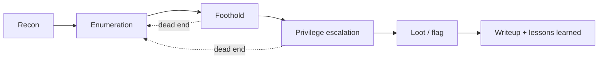

<div align="center">



<br>


**Notes, methodology and full exploit chains from the boxes and labs I've worked through.**
Written for future me, and for anyone learning the same path.

</div>

---

## `>_` About

I'm **Aws**, a CS graduate (TTU, 2026) heading for **junior SOC Analyst / Red Team** roles in Jordan and the MENA region.
This repo is my working notebook: every writeup explains the *why* behind each step (what I saw, what I tried, what failed), not just the final flag.

Also building [**SEC-SPACE**](https://sec-space.net), a web-based security toolkit and blog.

## `>_` Writeup index

| Platform | Challenge | Category | Key techniques |
|:--|:--|:--|:--|
| TryHackMe | `spring` | Web | Spring Boot actuator exposure, git repo leak, header-based IP spoofing |
| TryHackMe | `toc2` | Web / RCE | CMS Made Simple, installer backdoor to RCE |
| TryHackMe | `Dave's Blog` | Web | NoSQL injection, server-side JS injection (SSJI) |
| TryHackMe | `olie` | Web | phpIPAM SQL injection, hash cracking |
| TryHackMe | `Towel on the Sunbed` | Web | Race condition on a reward-claim endpoint (Burp parallel Repeater) |

> Add a row each time you push a new writeup and link the folder, e.g. ``[`spring`](./THM/spring)``.

## `>_` Methodology



Every writeup follows the same skeleton: **Summary → Recon → Foothold → Escalation → Mitigation → Takeaways**.
The mitigation section is the part I care about most, since that's the SOC side of the same story.

## `>_` Toolbox

<details>
<summary><b>Click to expand</b></summary>

- **Recon / enum:** nmap, gobuster / feroxbuster, ffuf
- **Web:** Burp Suite (Repeater, Intruder, parallel requests), sqlmap, curl
- **Binary / RE:** GDB + GEF, pwntools, Ghidra
- **Cracking:** hashcat, John the Ripper
- **Scripting:** Python (requests, pytesseract, pwntools)
- **Notes:** Obsidian (this repo is an exported vault)

</details>

## `>_` Repo layout

```text
CTF_Writeups/
├── THM/            # TryHackMe rooms
├── HTB/            # HackTheBox machines and challenges
├── PortSwigger/    # Web Security Academy labs
├── picoCTF/
└── pwn.college/
```

<sub>Example layout. Replace it with the output of `tree -L 2 -I .git`.</sub>

## `>_` Disclaimer

For **educational purposes only**. Every target here was a purpose-built lab or CTF environment I was authorized to attack.
Flags and credentials are redacted. Don't point any of this at systems you don't own or have written permission to test.

<div align="center">

**[sec-space.net](https://sec-space.net)** · **[github.com/ezlx1](https://github.com/ezlx1)**

<sub>`while true; do learn; break_stuff; document; done`</sub>

</div>
