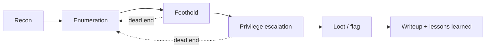

 

**Notes, methodology and full exploit chains from the boxes and labs I work through.**

---

## `>_` About

I'm **Aws**, a CS graduate (TTU, 2026) heading for **junior SOC Analyst / Red Team** roles in Jordan and the MENA region.

This repo is my working notebook. Every writeup explains the *why* behind each step (what I saw, what I tried, what failed), not just the final flag. It's a work in progress, and new writeups are added as I finish them.

## `>_` Methodology

Every writeup follows the same structure: **Summary → Recon → Foothold → Escalation → Mitigation → Takeaways**.

The mitigation section matters most to me, since that's the defensive (SOC) side of the same story.

## `>_` Disclaimer

For **educational purposes only**. Every target here is a purpose-built lab or CTF environment I was authorized to attack. Flags and credentials are redacted. Don't use any of this against systems you don't own or have written permission to test.

**[github.com/ezlx1](https://github.com/ezlx1)**

`while true; do learn; break_stuff; document; done`

